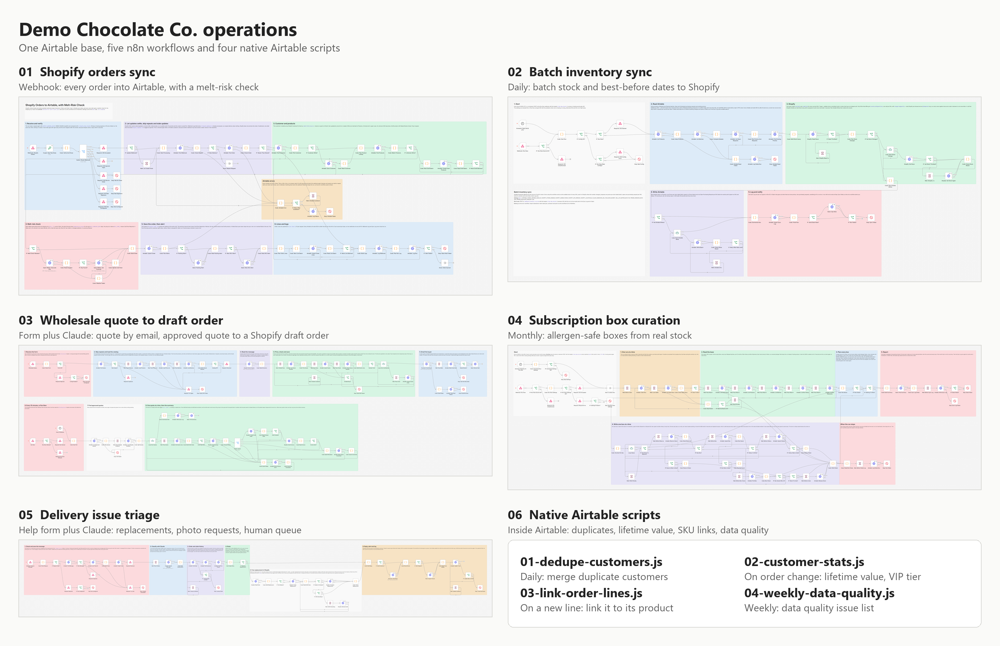

# Chocolate Shop Operations on Airtable: Shopify, n8n and Claude

One Airtable base and six automations that run the back office of Demo Chocolate Co., a made-up chocolate shop that sells on Shopify, takes wholesale orders and ships a monthly subscription box. Five automations are n8n workflows; the sixth is a set of scripts that run inside Airtable's own automations. Everything was tested end to end against strict mocks of the real APIs.



## The problem

A small food brand on Shopify usually runs its operations in a spreadsheet or an Airtable base: orders for the packing team, production batches with best-before dates, wholesale quotes, subscriber boxes, support tickets. Keeping that base in step with Shopify by hand does not scale, and the quick automations break exactly where it hurts. A webhook delivered twice becomes two orders. Stock typed into Shopify overwrites the sales that happened meanwhile. A short dated batch is noticed when it is too late to discount it. A hazelnut trace ends up in a nut-free box. A wholesale quote uses last year's price, or is invoiced twice. A box of bars shipped to Phoenix in July without a cold pack arrives as a puddle, and the support inbox fills up with the same lookups for every complaint.

## What this repo is

| # | Automation | What it does | Trigger | Tests |
|---|---|---|---|---|
| 01 | [Shopify orders sync, with melt-risk check](automations/01-shopify-orders-sync) | Copies every Shopify order into Airtable (customer, order, lines, unknown SKUs as Draft products) and checks the forecast at the shipping address, so the packing team knows which boxes need a cold pack | Shopify `orders/create` and `orders/updated` webhooks | 83/83 |
| 02 | [Batch inventory sync](automations/02-batch-inventory-sync) | Works out sellable stock per SKU from the production batches and their best-before dates, sets it in Shopify where it changed, proposes promos for short dated batches and opens purchasing requests below the reorder point | Daily at 06:00 UTC, plus a protected Run Now webhook | 71/71 |
| 03 | [Wholesale quote to draft order](automations/03-wholesale-quote-to-draft-order) | Reads a free text wholesale inquiry with Claude, prices it from the Airtable price list, checks stock and production capacity, emails the quote, and turns an approved quote into a Shopify draft order and invoice, exactly once | Website form webhook; every 15 minutes for approved quotes, plus Run Now | 100/100 |
| 04 | [Subscription box curation](automations/04-subscription-box-curation) | Plans every subscriber's monthly box from real stock: allergen and diet safe, no repeats, balanced flavors, fair use of scarce bars, stock reserved on the batches, a packing list per box | Monthly on the 20th at 08:00, plus Run Now | 133/133 |
| 05 | [Delivery issue triage](automations/05-delivery-issue-triage) | Turns melted, damaged and missing order complaints into tickets, classifies them with Claude, approves a free Shopify replacement when the order's own data backs a melt claim, asks for photos, and sends everything else to a person in Slack | Help form or email parser webhook | 81/81 |
| 06 | [Native Airtable scripts](automations/06-airtable-native-scripts) | Four scripts for Airtable's "Run a script" action, used by seven automations inside the base: merge duplicate customers, keep lifetime value and VIP tier current, link order lines to products by SKU, and write a weekly data quality report | Airtable automation triggers (record created or updated, schedules) | 94/94 |

The test numbers are from the integration run on 2026-10-22, one automation at a time on n8n 2.19.5. The full summary is in [docs/test-report.md](docs/test-report.md), and each folder has its own README and test report.

## How it fits together

```mermaid
flowchart LR
    subgraph Sources[Where the work comes from]
        SH[Shopify store]
        WF[Website wholesale form]
        HF[Help form or email parser]
        SC[Schedules]
    end
    subgraph N8N[n8n workflows]
        A1[01 Shopify orders sync]
        A2[02 Batch inventory sync]
        A3[03 Wholesale quote to draft order]
        A4[04 Subscription box curation]
        A5[05 Delivery issue triage]
    end
    subgraph AT[Airtable base]
        T1[(Orders, Order Lines,<br/>Customers, Webhook Log)]
        T2[(Products,<br/>Production Batches)]
        T3[(Price List, Quotes,<br/>Quote Lines)]
        T4[(Subscribers, Box Shipments,<br/>Box History)]
        T5[(Tickets)]
        T6[(Promos, Purchasing Requests,<br/>Sync Log, Data Quality)]
        A6[06 Native Airtable scripts]
    end
    ER[Error alert workflow] --> SL[Slack ops channel]
    SH -- order webhooks --> A1
    A1 --> T1
    SC -- daily --> A2
    T2 --> A2
    A2 -- set stock --> SH
    A2 --> T6
    WF --> A3
    T3 <--> A3
    A3 -- draft order and invoice --> SH
    SC -- monthly --> A4
    A4 <--> T4
    A4 -- reserve stock --> T2
    HF --> A5
    A5 <--> T5
    A5 -- free replacement --> SH
    A6 <--> T1
    A6 --> T6
    N8N -. any failed run .-> ER
```



The Airtable base is the center: all six automations work on the same base of 17 tables, and Shopify is kept in step from it. A few links between the automations are worth knowing:

- **02 and 04 share the stock rule.** 04 reserves units on the production batches (Quantity Reserved), and 02 stops offering those units on Shopify at its next run. 03 uses the same sellable stock rule to decide whether a quote can ship from stock.
- **05's replacements come back through 01.** A completed replacement order is a normal Shopify order, so 01 receives it as `orders/create` (total 0, tagged `replacement`) and the packing team sees it like any other order.
- **06 cleans up after the others.** 01 writes customers and order lines exactly as Shopify sends them; the scripts merge duplicate customers, recalculate lifetime value, link messy SKUs to products and report what still needs a person.
- **Each automation also calls outside services:** 01 uses Open-Meteo for the forecast, 03 and 05 use Claude to read messages and Postmark to send email, and 01 to 05 post to Slack.

## The Airtable base

17 tables, from Products and Production Batches to Tickets and Data Quality, with 362 fake seed records. The blueprint is [base/schema.json](base/schema.json) (real Airtable field types and options), the seed data is in [base/seed](base/seed), and [base/README.md](base/README.md) explains every table with two Mermaid ER diagrams, the keys that keep reruns from creating duplicates, and the traps the seed contains on purpose (duplicate customers, a batch past its best-before date that is still marked Released, a product with only a nut trace warning, and more).

### Build it in your own Airtable account

Create an empty base, copy its id (`appXXXXXXXXXXXXXX` from the URL) and create a personal access token with the scopes `schema.bases:read`, `schema.bases:write`, `data.records:read` and `data.records:write` for that base. Then:

```
AIRTABLE_TOKEN=pat... AIRTABLE_BASE_ID=app... python setup/create_base.py --dry-run
AIRTABLE_TOKEN=pat... AIRTABLE_BASE_ID=app... python setup/create_base.py --shift-dates-to-today
```

The script creates the tables and fields through the Metadata API and loads the seed through the Web API, paced to 4 requests per second. It is safe to run again: existing tables and fields are skipped, and seeded records are remembered in `setup/.seed-state.local.json` (git ignored), so a second run creates nothing new. `--dry-run` prints the plan and writes nothing, `--no-seed` builds an empty base for real use, and `--shift-dates-to-today` moves the seed dates so that facts such as "best before in 15 days" hold today. Delete the default "Table 1" by hand afterwards.

The whole system setup, with every service, scope and variable, is in [docs/setup.md](docs/setup.md).

## Running it

The workflows read their settings with `$env`, so they need **self-hosted n8n 2.x with `N8N_BLOCK_ENV_ACCESS_IN_NODE=false`**. n8n Cloud does not allow `$env`: there, replace `$env.` with `$vars.` in the workflow files and create the same names as Variables.

1. Build the base (above).
2. Import [shared/error-alert-slack.json](shared/error-alert-slack.json) into n8n and **activate it**. n8n 2.x skips an error workflow that is not active, so without this no failure alert ever arrives.
3. Set the variables from [.env.example](.env.example) in the n8n environment and restart n8n.
4. Import the workflows you want from `automations/*/workflow/`, choose the error alert workflow as the **Error Workflow** in each one's settings, and activate them.
5. Point Shopify, the website form and the help form at the webhook URLs, and paste the four Airtable scripts into Airtable automations. [docs/setup.md](docs/setup.md) has every step.

## Testing

Nothing here was tested against a real Airtable base, Shopify store or inbox. Every test runs the real workflow in a real n8n against mock APIs that live in [tests/mocks](tests/mocks/README.md): Airtable (Web API and Metadata API, with a filterByFormula engine), Shopify Admin GraphQL (a strict GraphQL engine) and signed webhooks, Open-Meteo, Postmark, Slack incoming webhooks and the Claude Messages API. The mocks are strict on purpose, so a passing test means the request would also be accepted for real. They reject what the real APIs reject, with the real error bodies: a sixth Airtable request inside one second (then 30 seconds of 429), more than 10 records per write, unknown fields and wrong types, an upsert key of a type Airtable does not allow, a bad formula, an unknown GraphQL field, an `inventorySetQuantities` call without `@idempotent`, a Claude request with sampling parameters, an email from an unconfirmed sender. Each rule was checked against the official API docs in October 2026. The Claude requests of 03 and 05 were also checked against Anthropic's free token counting endpoint, which validates a request without generating anything.

Automation 06 runs in Airtable, not n8n, so its scripts run unchanged inside a strict stand-in for Airtable's scripting environment, and a mutation check proves the suite fails when the scripts are broken on purpose.

| Suite | Checks passed | Time in the integration run |
|---|---|---|
| Shared mocks and `setup/create_base.py` | 83/83 unit tests | 1 minute |
| 01 Shopify orders sync | 83/83 | 7 minutes |
| 02 Batch inventory sync | 71/71 | 3 minutes |
| 03 Wholesale quote to draft order | 100/100 | 5 minutes |
| 04 Subscription box curation | 133/133 | 17 minutes |
| 05 Delivery issue triage | 81/81 | 4 minutes |
| 06 Native Airtable scripts | 94/94, and 18 of 18 deliberate mistakes caught | 5 minutes, most of it the mutation check |

### Run the tests yourself

You need Python 3.9 or later (tested on 3.14), Node 18 or later (tested on 24) for 06, and an n8n 2.x with the public API enabled (tested on 2.19.5 in Docker) for 01 to 05. Nothing else needs to be installed, with one exception on Windows: the Open-Meteo mock uses Python's `zoneinfo`, which has no time zone data there, so run `pip install tzdata` once. No real API is called.

```
python -m unittest tests.mocks.test_mocks -v
python automations/01-shopify-orders-sync/tests/e2e_mock_test.py
python automations/02-batch-inventory-sync/tests/e2e_mock_test.py
python automations/03-wholesale-quote-to-draft-order/tests/e2e_mock_test.py
python automations/04-subscription-box-curation/tests/e2e_mock_test.py
python automations/05-delivery-issue-triage/tests/e2e_mock_test.py
python automations/06-airtable-native-scripts/tests/e2e_mock_test.py
```

Run them from the repo root with these set:

| Variable | What it is |
|---|---|
| `N8N_URL` | Default `http://localhost:5678` |
| `N8N_API_KEY` | An n8n API key (Settings, n8n API). Or `N8N_ENV_FILE` pointing at a `.env` file that has it; from Git Bash with Windows Python, write that path as `C:/Users/...` |
| `MOCK_HOST` | How n8n reaches the mocks on your machine. Default `host.docker.internal` (n8n in Docker); `127.0.0.1` when n8n runs directly on this machine |

Each suite starts its own mock server on its own port (8790 for the unit tests, 8791 to 8795 for 01 to 05; 06 needs neither n8n nor a port). The n8n suites import temporary copies of their workflow and of the error workflow, named `TEST <slug> (temporary)`, and delete them when they finish, even after a failure. It never touches any other workflow. Run the n8n suites one at a time: each has its own mock server, but they all load the same n8n, and a busy n8n starts error workflows late. Some scenarios wait out Airtable's real 30 second block on purpose, which is most of the run time.

## How failures are handled

The same rules run through all six automations:

- **Answer first, work after.** Shopify wants a webhook answered within 5 seconds and the forms should not hang, so the webhooks answer right away (after the signature or secret check, and for a support message after its ticket is saved) and do the slow work afterwards.
- **Fail closed.** A wrong or missing signature or secret gets 401 and nothing is read or written. A secret that is not configured refuses everything instead of letting everything in.
- **Never twice.** Every write is an upsert on a stable key or an update by record id, so a retry or a rerun never duplicates anything: Shopify webhook ids are logged, Shopify stock updates carry an idempotency key, draft orders carry a `quote-<number>` or `replacement-for-<order>` tag that is checked before anything is created, and box, promo and request names are derived from what they are for.
- **Respect the rate limit.** Airtable allows 5 requests per second per base and then blocks the base for 30 seconds. The workflows send at most 10 records per write and pace their own calls to at most 4 per second. When Airtable still answers 429, they wait out the 30 second block before they try again, or stop before anything has changed.
- **Retry, then tell a person.** External calls are tried 3 times. After that, the user-facing step comes first (a holding email, a 503 the form can retry, a ticket in the human queue), then the run ends as failed so the active error workflow posts the reason to Slack. A run that only partly worked says so in Sync Log.
- **Claude reads, code decides.** Claude only extracts or classifies, through a forced tool call with a strict schema. Prices, approvals and replacements are decided by plain code from the base's own data. When Claude is down, refuses or answers without the tool, a rule-based fallback takes over and the case always goes to a person.
- **Unsure cases go to a person.** Two Shopify customer ids on one email, a SKU shared by two products, a melt claim without the data to back it, an allergy question: these are flagged, never guessed.
- **One writer per number.** Sellable stock, totals, lifetime value and VIP tier are plain fields written by one tested automation each, not formulas that several tools touch.

## Limitations

- **Tested against mocks, not live services.** The mocks follow the official docs, and the request shapes were checked where a free check exists, but none of this has run against a real Airtable base, Shopify store, Postmark server or Slack workspace. Where the docs are silent the mocks pick the stricter behavior, and real services can still differ in error texts and timing.
- **The rate limit is shared.** Airtable's 5 requests per second apply to the whole base. Each workflow paces itself, but they do not coordinate, so several automations bursting at the same moment can still trip a 429. They recover through the cooldown, but at flash sale volumes a queue in front of the webhooks would be better. Stagger the schedules (02 at 06:00 UTC, 04 on the 20th at 08:00, the 06 scripts at 02:00, 05:00 and Monday 07:00).
- **No lock between overlapping runs** in a few places, for example a Run Now call that overlaps the 15 minute run of 03, or two copies of one support message at the very same moment. Each case and what happens then is listed in the automation's README.
- **Self-hosted n8n.** The workflows read `$env`; n8n Cloud needs the `$vars.` change above. API keys live in environment variables; for production, move them into n8n credentials and set an execution data retention period, because runs contain customer data.
- **The shared error workflow posts the error text to Slack as it is.** 01 neutralises the untrusted text it puts into its own errors; the other automations write their own messages, but escaping inside the error workflow itself is a next step.
- **One store, one location, one currency (USD), English only.** Open-Meteo's free API is for non-commercial use; a real shop needs an Open-Meteo plan.
- Each automation's README lists its own limitations and next steps.

## Repository layout

```
base/                      Airtable blueprint (schema.json), seed data and the tables explained
setup/create_base.py       builds the base through the Metadata API and loads the seed
shared/                    error-alert-slack.json, the error workflow every n8n workflow uses
automations/NN-<slug>/     README, workflow (or scripts), tests, docs/test-report.md, canvas image
tests/mocks/               the shared strict mock APIs and the n8n test helpers
docs/setup.md              setup for the real services, end to end
docs/test-report.md        the test results of every suite
.env.example               every variable, with comments
CHANGELOG.md               what is in v1
```

## About

Built by **Romiel Inolino**, AI and CRM Automation Specialist working with GoHighLevel, Monday.com, ClickUp, n8n, Make and Zapier.
Portfolio and case studies: [romielwillautomate.dev](https://romielwillautomate.dev)

This repository is a portfolio implementation. Credentials, API keys and customer data are not included, and all test data is made up.
