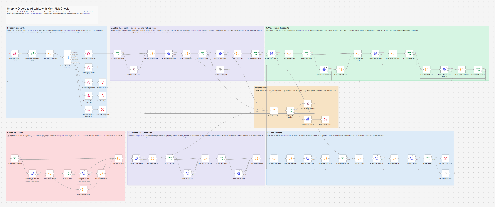
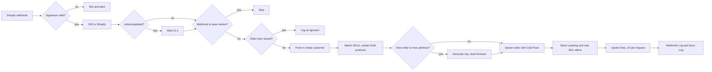

# Shopify Orders to Airtable, with Melt-Risk Check

An n8n workflow that copies every Shopify order into Airtable (customer, order, line items and products) and checks the weather at the shipping address, so the packing team knows which boxes need a cold pack. Automation 01 of the [Demo Chocolate Co. operations base](../../README.md).



## The problem

A chocolate shop that sells on Shopify and runs its operations in Airtable needs each order in Airtable within seconds: the packing team works from it, support looks orders up there, and customer and stock numbers are built on it. The quick automations break exactly where it hurts. A webhook delivered twice becomes two orders. Two customer records share one email, so an upsert on Email fails. A refund or a fulfilment never reaches the order. A new SKU arrives that Airtable has never seen. And in summer, a box of bars shipped to Phoenix without a cold pack arrives as a puddle, which costs a replacement and often a customer.

## What this does

1. **Takes Shopify's orders/create and orders/updated webhooks**, checks the HMAC signature and answers Shopify with 200 straight away. The work happens after the answer.
2. **Never processes a webhook twice.** Every `X-Shopify-Webhook-Id` is logged in Webhook Log, and an update older than the version already stored is ignored, because Shopify does not promise the order of webhooks. That check runs again when a run restarts after an Airtable cooldown, so a newer version saved in the meantime is never overwritten.
3. **Finds the customer** by Shopify Customer ID, then by email (compared trimmed and in lower case), and updates that record or creates a new one. It never upserts on Email, so the duplicate emails in the base cannot break it.
4. **Saves the order and every line item** as upserts on Shopify Order ID and Line Item ID, linked to the customer and to the products by SKU. Payments, fulfilments, refunds, cancellations and address changes update the same records.
5. **Creates a Draft product for an unknown SKU**, with Needs Review ticked and a reason, flags the order and tells the ops channel. A SKU that already exists as a Draft is matched, not created again.
6. **Keeps the gift message** for the packing slip.
7. **Checks the melt risk.** Open-Meteo finds the shipping city and its daily forecast. If any of the next 3 days (`MELT_FORECAST_DAYS`) reaches 27 C (`MELT_TEMP_C`), Cold Pack is set to Required and the packing team gets a Slack message. If the weather service fails or cannot find the city, Cold Pack is Review and the note says why.
8. **Respects Airtable's limit** of 5 requests per second per base: at most 10 records per request, 500 ms between calls, and a 31 to 60 second cooldown and fresh start when Airtable still says 429.
9. **Fails safely.** Forged webhooks are refused, every failure ends in a clear Slack alert through the error workflow, and Webhook Log and Sync Log show what happened to each webhook. Text that comes from customers or from unsigned headers is made safe before it reaches Slack, so a gift note or a forged header cannot ping `@channel` or post a link.

## How it works



Shopify wants a 200 within 5 seconds and retries for 4 hours otherwise, so the workflow answers first and then does the paced Airtable work and the weather calls.

Shopify often sends orders/updated a moment after orders/create for the same order. If both ran at once, both would see a new order, check the weather twice and alert twice. So an orders/updated waits 10 seconds before it starts, and the create is saved first.

Every Airtable call waits 500 ms after the previous one. One run then makes at most 2 calls in any second, and two webhooks processed at the same moment stay at 4, under Airtable's 5. If Airtable still answers 429 (or a 5xx, or nothing) after 3 tries, the run waits 31 to 60 seconds (Airtable blocks a base for 30 seconds after a burst; the random part keeps blocked runs from coming back together) and starts the webhook again from the top. That is safe because every write is an upsert or an update by record id, the run remembers which Slack alerts it already sent and what the weather check found, and it looks at the stored order again: if another webhook saved a newer version during the cooldown, this one is logged as Ignored instead of writing older data over it.

## Workflow at a glance

| Step | Nodes | What it does |
|---|---|---|
| 1 | Webhook: Shopify Orders, Crypto: Sign Raw Body, Code: Verify And Parse, Switch: Route Webhook | Receives the webhook with its raw body, signs the raw body again with `SHOPIFY_WEBHOOK_SECRET` (HMAC SHA256, base64), compares it with `X-Shopify-Hmac-Sha256` and reads the order |
| 2 | Respond: 200 Accepted, Respond: 200 Ignored Topic, Respond: 200 Not An Order, Respond: 401 Bad Signature, Respond: 500 Not Configured, Stop: Not An Order, Stop: Bad Signature, Stop: Not Configured | 200 for an order, 200 "ignored" for another topic, 200 and an alert for a signed body that is not an order, 401 and an alert for a bad signature, 500 and an alert when no secret is set |
| 3 | IF: Update Webhook?, Wait: Let Create Finish | An orders/updated waits 10 seconds |
| 4 | Code: Start Processing, Airtable: Find Webhook, Code: Check Repeat, IF: New Delivery?, Done: Repeat Skipped | Skips a webhook id that is already Processed in Webhook Log |
| 5 | Airtable: Find Order, Code: Check Order, IF: Newer Than Stored? | Skips a webhook older than the stored Shopify Updated At, and decides whether the melt check runs |
| 6 | Airtable: Find Customer, Code: Pick Customer, IF: Customer Write?, Airtable: Save Customer, Code: Read Customer | Customer lookup by id, then by email, then an update by record id or a create |
| 7 | Code: Plan Product Lookup, Airtable: Find Products, Code: Match Products, IF: Unknown SKUs?, Code: Next Draft Batch, Airtable: Create Draft Products, Code: Read Draft Batch, IF: More Draft Batches? | Matches SKUs and creates Draft products, 10 per request |
| 8 | IF: Melt Check Needed?, Open-Meteo: Geocode City, Code: Read Location, IF: City Found?, Open-Meteo: Get Forecast, Code: Decide Cold Pack, Code: Weather Failed | The melt-risk check |
| 9 | Code: Build Order, Airtable: Upsert Order | One upsert on Shopify Order ID |
| 10 | Code: Plan Alerts, IF: Packing Alert?, Slack: Packing Alert, Code: Note Packing Alert, IF: New SKU Alert?, Slack: New SKU Alert, Code: Note SKU Alert | Slack alerts, right after the order is saved so a later failure cannot swallow them |
| 11 | Code: Plan Order Lines, Code: Next Line Batch, Airtable: Upsert Order Lines, Code: Read Line Batch, IF: More Line Batches? | Upserts the lines on Line Item ID, one request of at most 10 per pass |
| 12 | Code: Build Logs, Airtable: Log Webhook, Code: Plan Run Log, Airtable: Log Run, IF: Alert Failed?, Stop: Slack Alert Failed, Done: Order Synced | Webhook Log and Sync Log rows, then fails the run if a Slack alert could not be posted |
| Errors | Code: Airtable Error, IF: Retry After Cooldown?, Wait: Airtable Cooldown, Airtable: Log Failure, Stop: Airtable Failed | Every Airtable node's error output: cooldown and restart, or log and stop |

## The melt-risk rule

Cold Pack is **Required** when any daily maximum temperature (`temperature_2m_max`) in the next `MELT_FORECAST_DAYS` days, today included and in the destination's time zone, is at or above `MELT_TEMP_C`. The check runs for a new order, when the shipping address changes, and when the last result was Review. Later updates keep the earlier result, so the packing team is not told twice. Cancelled and fully fulfilled orders are not checked.

From the test run (the forecasts come from the mock, so they are made up):

| Ship to | Highest maximum, next 3 days | Cold Pack |
|---|---|---|
| Phoenix, AZ | 37.1 C | Required, packing alert |
| Austin, TX | 30.1 C | Required, packing alert |
| Denver, CO, with 27.0 C on day 2 | 27.0 C | Required (the limit itself counts) |
| Atlanta, GA | 26.1 C | Not Needed |
| Boston, MA, with 35 C only on day 4 | 12.0 C | Not Needed (day 4 is outside the window) |
| Springfield, IL (the geocoder has no match) | none | Review, packing team told to check by hand |
| Any city while the weather service is down | none | Review, packing team told to check by hand |
| Honolulu, HI, with no value for day 2 | none | Review (the forecast is incomplete) |
| No shipping address (pickup or digital) | none | Not Needed, no weather call |

The geocoding query is `City, ST` with the country as a filter (`Austin, TX`, `countryCode=US`). The Open-Meteo geocoding docs allow a country or a first-level administrative area after the comma (a state name or its abbreviation) and match it exactly, so `Austin, TX` and `Austin, Texas` work and `Austin, Tex` does not. The workflow asks for up to 10 results, so a qualified match is not cut off, and uses the first one. A place it cannot find, or a forecast with a missing day, is Review, never a guess.

## What gets written

| Table | Matched on | Fields this workflow writes |
|---|---|---|
| Customers | Shopify Customer ID, then `LOWER(TRIM({Email}))` | A new customer gets Name, Email (lower case), Phone, Shopify Customer ID, Created Via Shopify, Accepts Marketing and Record Status Active. An existing one only gets an empty Name, Phone or Shopify Customer ID filled in, and Accepts Marketing ticked when the order says so. Nothing there is overwritten. A Duplicate record that points to its survivor in Merged Into is swapped for the survivor. |
| Products | SKU, trimmed and in upper case | Only for an unknown SKU: SKU, Name, Status Draft, Needs Review, Review Reason (with the Shopify variant id), Price |
| Orders | Shopify Order ID (upsert) | Order Number, Customer, Email, Order Date, Shopify Updated At, Financial Status, Fulfillment Status, Order Status, Cancelled At, Subtotal, Shipping, Tax, Total, Refunded Amount, Currency, Shipping Name, Shipping Address, Shipping City, Shipping Region, Shipping Country, Shipping Postal Code, Is Gift, Gift Note, Shopify Tags. Cold Pack, Forecast Max C, Melt Check Note and Melt Checked At when the check ran. Needs Review and Review Reason only when there is a new reason, so a flag a person cleared is not set again. |
| Order Lines | Line Item ID (upsert) | Order, Product, SKU (as Shopify sent it), Product Title, Quantity, Current Quantity, Refunded Quantity, Unit Price, Line Total, SKU Status (Matched, Missing SKU, or Unknown SKU when a SKU could not be linked) |
| Webhook Log | Event ID, the `X-Shopify-Webhook-Id` (upsert) | Source, Topic, Received At, Status (Processed, Ignored or Failed), Order, Notes |
| Sync Log | Run ID `orders-<webhook id>` (upsert) | Automation 01 Shopify Orders, Trigger Webhook, Started At, Finished At, Status (Success or Partial), Items Checked (line items), Items Changed (records written), Shopify Updates 0, Errors, Details |

Gift orders are recognised by a cart attribute whose name contains "gift" (for example `Gift` = `Yes`, or `Gift Message` = `Happy birthday`) or by the tag `gift`. The gift message comes from a "gift message" or "gift note" attribute, otherwise from the order note.

The workflow never writes Cold Pack Shipped, Shipped At, Expected Delivery, Delivered At or Tracking Number (the packing team and delivery tracking own those), nor the customer statistics (the Airtable scripts in 06 own those).

## What the team gets

From the test run (all data made up):

```
:snowflake: *Cold pack needed* for order <https://admin.shopify.com/store/demo-chocolate/orders/5200000001026|#1026>
Forecast max 37.1 C over the next 3 days in Phoenix, Arizona (cold pack from 27 C).
Ship to: New Buyer, Phoenix, AZ, 85004
Items: 2 x Dark 70% Sea Salt Bar, 1 x Milk Salted Caramel Bar
```

```
:warning: *Check the cold pack by hand* for order <https://admin.shopify.com/store/demo-chocolate/orders/5200000001037|#1037>
Melt check failed: the Open-Meteo geocoding service answered HTTP 500 after 3 tries. Cold Pack set to Review, check the forecast for Houston, TX, US by hand.
Ship to: Tom Becker, Houston, TX, 77002
Items: 1 x Dark Chili Cinnamon Bar
```

```
:package: *New SKU from Shopify* on order <https://admin.shopify.com/store/demo-chocolate/orders/5200000001030|#1030>
DC-BAR-GINGER (Dark Ginger Bar) is not in Airtable, so a Draft product was created with Needs Review ticked. Add allergens, ingredients and stock rules, then set it to Active.
```

A gift order adds a line `Gift note for the packing slip: "..."` to the packing message, and an address change from a hot city to a cold one sends "Cold pack no longer needed". Gift notes, names, addresses and product titles are escaped the way Slack documents (`&`, `<` and `>` become `&amp;`, `&lt;` and `&gt;`), so a note such as `<!channel>` shows as text and pings nobody. Airtable keeps the note exactly as the customer typed it.

## Setup

**You need:** self-hosted n8n 2.x reachable over HTTPS, the Demo Chocolate Co. base built from [base/schema.json](../../base/schema.json) (see [docs/setup.md](../../docs/setup.md)), a Shopify store where you can add webhooks and, optionally, two Slack incoming webhooks.

1. Import `workflow/shopify-orders-sync.json` into n8n.
2. Import [`shared/error-alert-slack.json`](../../shared/error-alert-slack.json), **activate it**, and choose it as the **Error Workflow** in this workflow's settings. It has to be active: n8n 2.x skips an error workflow that is switched off, so no alert would arrive.
3. Add the variables below to your n8n environment and restart n8n. The nodes read them with `$env`, so self-hosted n8n needs `N8N_BLOCK_ENV_ACCESS_IN_NODE=false`. (n8n Cloud does not allow `$env`. There, replace `$env.` with `$vars.` and create the same names under Variables.)
4. Activate the workflow. Its URL is `https://YOUR-N8N-DOMAIN/webhook/shopify-orders`.
5. In Shopify, send **orders/create** and **orders/updated** to that URL. Step by step, including where the signing key is: [docs/shopify-setup.md](docs/shopify-setup.md).

| Variable | Required | Where to find it |
|---|---|---|
| `AIRTABLE_TOKEN` | yes | airtable.com/create/tokens. Scopes `data.records:read` and `data.records:write`, access to this base only |
| `AIRTABLE_BASE_ID` | yes | The `appXXXXXXXXXXXXXX` part of the base URL |
| `SHOPIFY_WEBHOOK_SECRET` | yes | The key Shopify signs the webhooks with: shown on Settings > Notifications > Webhooks for webhooks made there, or the app's client secret. Without it every webhook is refused with 500 |
| `SHOPIFY_STORE_DOMAIN` | no | `your-store.myshopify.com`, only used for the "open in Shopify" link in Slack messages |
| `SLACK_PACKING_WEBHOOK_URL` | no | Incoming webhook of the packing channel (cold pack alerts). Falls back to `SLACK_WEBHOOK_URL` |
| `SLACK_WEBHOOK_URL` | no | Incoming webhook of the ops channel (new SKU alerts). The error workflow posts here too |
| `MELT_TEMP_C` | no | Cold pack from this daily maximum, in Celsius. Default `27` |
| `MELT_FORECAST_DAYS` | no | Days of forecast to check, today included, 1 to 16. Default `3` |

No Shopify access token is needed: every webhook carries the whole order, so the workflow never calls the Shopify API.

The timing rules are constants in the nodes, easy to change: 500 ms between Airtable calls (the Code nodes before each Airtable call), 10 seconds for orders/updated (**Wait: Let Create Finish**), and 3 attempts with a 31 to 60 second cooldown (**Code: Airtable Error**).

## Testing

The workflow was tested end to end on n8n 2.19.5 against the repo's shared mocks of Airtable, Open-Meteo and Slack ([tests/mocks](../../tests/mocks/README.md)), so no real store, base or workspace was touched. The mocks are strict: the Airtable mock enforces 5 requests per second per base (the 6th gets 429 and the base is blocked for 30 seconds), at most 10 records per write, exact field names and types, select options, link record ids and the upsert rules, and it answers with Airtable's real error bodies. Shopify webhooks were signed exactly like Shopify signs them.

All 83 checks pass: 34 scenarios run through n8n, plus a check of every request in the run and a cleanup check. The final run took 411 seconds.

| Scenario | Result |
|---|---|
| New order to Phoenix, new customer | 200 to Shopify in under 0.1 s; customer created with an upsert on Shopify Customer ID; order and 2 lines with the exact values; Cold Pack Required at 37.1 C; one packing alert; exactly 9 Airtable requests, at least 500 ms apart |
| Same webhook delivered twice, and the webhook id already in the seeded Webhook Log | Skipped after one lookup, no writes, no weather call, no Slack |
| orders/updated with a refund and a fulfilment | Same Orders record updated (Partially Refunded, Fulfilled, 7.50 refunded), line 1 shows 1 of 2 with 1 refunded, no new lines, no second melt check |
| An older orders/updated arriving late | Every cell of the order unchanged, logged as Ignored and linked to the order, 4 Airtable requests |
| jordan (two records share the email) | Matched by Shopify Customer ID, not the duplicate |
| Messy email ` Maya.Chen@Example.COM` with an unknown customer id | Matched by email to the record with a Shopify id, email stored in lower case |
| kai (email only, no name or id) | Same record updated by record id with name, id and phone |
| Guest checkouts without a customer id: jordan, a new guest, an order with no email at all | jordan's record with the Shopify id wins over the duplicate; the new guest is created with a plain POST and found by email on the next webhook; the order without email is saved unlinked and flagged |
| Unknown SKU, an existing Draft SKU, ` dc-bar-milk-caramel`, a gift wrap line without SKU | One Draft product created and linked, the existing Draft matched, the messy SKU matched, the gift wrap line Missing SKU at 0; order flagged; one ops alert. The update afterwards changes nothing extra |
| 12 unknown SKUs on one order | Draft products in upserts of 10 and 2 records, all 12 lines linked, one ops alert naming all 12, 12 reasons on the order |
| Gift message attribute; tag "gift" with the note | Gift Note stored; the packing alert carries it |
| A gift note with `<!channel>` and a disguised link; a name with `&` and `<>` | Escaped in the packing alert (no ping, no link); Airtable keeps the note as typed |
| Threshold edges (26.1 C, exactly 27.0 C, a hot day 4, `Austin, TX`) | Not Needed, Required, Not Needed, Required |
| Geocoding down, forecast down, a forecast with a null day, an unknown city | Order saved with Cold Pack Review and the reason; packing team told to check by hand; Sync Log Partial. The next update checks again and turns Review into Required |
| Pickup order without a shipping address | Not Needed, no weather call |
| 23 line items | Line upserts of 10, 10 and 3 records, all 23 linked, no 429 |
| orders/create and orders/updated for one new order, delivered together | One order with the newer state, one customer, one melt check, one packing alert |
| Two new orders at the same moment, real rate limiter on | No 429, busiest second 4 requests |
| Airtable 429 three times on the order upsert | Cooldown, fresh start, one order, one customer, one packing alert, logged as Processed |
| A newer orders/updated is saved while the create waits out its cooldown | The restarted create writes nothing and is logged as Ignored; the order keeps the newer state (Paid); one customer, one line, one packing alert |
| Airtable 422 on the lines | Run stops (no cooldown for a 4xx), Webhook Log Failed, alert with the step and Airtable's message; the packing alert had already gone out; the next orders/updated repairs it |
| Two Orders rows with the same Shopify Order ID | Airtable's 422 stops the run, and the alert says which rows to merge |
| Packing Slack webhook down | Order and lines saved, Sync Log Partial, run marked failed so the error workflow tells ops |
| Cancelled order; address changed to a cold city | Order Status Cancelled and Voided; melt check again and "Cold pack no longer needed" |
| Wrong signature, no signature, another secret, an empty POST | 401, nothing read or written, alert |
| A forged call with Slack markup in its headers | 401, and the alert shows the header values with `?` in place of `<`, `>`, `&` and the like |
| A body that is not JSON; another topic; a signed body that is not an order | 422 from n8n itself; 200 "ignored"; 200 and an alert |
| `SHOPIFY_WEBHOOK_SECRET` not set | 500 for a correctly signed webhook, nothing read |
| `MELT_TEMP_C=35`, `MELT_FORECAST_DAYS=2`, no packing webhook | Tucson 34.6 C Not Needed with 2 forecast days; Phoenix Required with the alert on `SLACK_WEBHOOK_URL` |
| Wrong `AIRTABLE_TOKEN` | Shopify still gets 200; the run stops at the first lookup with an alert naming 401 AUTHENTICATION_REQUIRED |

Full results and the exact requests the workflow sent: [docs/test-report.md](docs/test-report.md). Run the same test yourself with [tests/e2e_mock_test.py](tests/e2e_mock_test.py) (6 to 9 minutes: every orders/updated waits 10 seconds on purpose, and two scenarios wait out an Airtable cooldown).

## Failure handling

| What goes wrong | What happens |
|---|---|
| Wrong or missing signature | 401, nothing is read or written, the run fails so the error workflow alerts Slack |
| `SHOPIFY_WEBHOOK_SECRET` not set | 500 for every webhook (nothing is trusted) and an alert. Shopify keeps retrying for 4 hours, so the orders arrive once the secret is set |
| A signed webhook that is not an order, or another topic | 200 so Shopify does not retry; an alert for the first, nothing for the second |
| The same webhook twice | Skipped, Webhook Log already says Processed |
| An update older than the stored one | Logged as Ignored, nothing overwritten |
| Airtable rate limit, a 5xx or no answer | 3 tries, then a 31 to 60 second cooldown and a fresh start, up to 3 attempts. After that, as below |
| A newer webhook for the order is saved during that cooldown | The restarted run sees the newer Shopify Updated At, writes nothing over it and is logged as Ignored, with a note on what its first attempt had already done |
| Airtable refuses a write (4xx) | 3 tries, then Webhook Log Failed and an alert with the order, the step and Airtable's message. The next orders/updated for that order writes it again, because every webhook carries the whole order |
| Open-Meteo down or the city not found | The order is saved with Cold Pack Review and a note that says why, the packing team is asked to check by hand, Sync Log says Partial. The next update for the order checks again |
| Slack down | The order is fully saved, then the run is marked failed so the error workflow tells ops; the message says what to tell the packing team |
| Slack markup in a gift note, a name or a forged header | Escaped (customer text) or replaced with `?` (header values in alerts), so nobody is pinged and no link is posted |

## Footprint

A new order with up to 10 lines makes 8 Airtable requests (9 when the customer is new or gets new details), plus one per further 10 lines and one per 10 new SKUs, 2 Open-Meteo requests and 0 to 2 Slack posts. An update usually makes 8 Airtable requests and no weather or Slack call. With 500 ms between Airtable calls, a new order is in Airtable about 5 seconds after Shopify's 200, an update about 15 seconds after (10 of them waiting).

## Limitations and next steps

- Two orders/updated for the same order processed in the same seconds can finish in either order. The stale check protects against webhooks that arrive late and against a run that restarts after a cooldown, not against two runs writing at the same moment, so Airtable can show the state one webhook older until the next update. Two such runs for a new order can also both send the packing alert. A queue that handles one order at a time would remove this.
- Every forged or unsigned call to the webhook URL posts an error alert. That is useful while the URL is private; if it leaks and gets scanned, change the webhook path in n8n and in Shopify.
- The rate limit is shared by everything that uses the base. Two parallel webhooks fit; three at the same moment, or another automation in a burst, can trip it. The cooldown path then recovers, up to 3 attempts. At flash sale volumes, put a queue in front.
- The forecast covers the next days from today, not the actual delivery days, and later updates keep the first result. A shipment delayed into a heatwave is not checked again; a daily re-check of unfulfilled orders on the shipping day would cover it.
- Line Total is Shopify's line price times the current quantity, before discounts. The order's Subtotal and Total are Shopify's amounts after discounts.
- Existing customers are never overwritten, so an email change in Shopify is not copied to Airtable.
- A customer without a Shopify customer id is created with a plain create, so two webhooks for such a customer at the same moment could create two records. Orders from the online store always have a customer id.
- Open-Meteo's free API is for non-commercial use. A real shop needs an Open-Meteo plan, which uses the `customer-` host and an `apikey` parameter: change the two Open-Meteo URLs and add the key.
- API keys are read from environment variables. For production, move the Airtable token into an n8n Header Auth credential.
- Webhook Log and Sync Log get one row per webhook. Archive old rows now and then.

## About

Built by **Romiel Inolino**, AI and CRM Automation Specialist working with GoHighLevel, Monday.com, ClickUp, n8n, Make and Zapier.
Portfolio and case studies: [romielwillautomate.dev](https://romielwillautomate.dev)

This repository is a portfolio implementation. Credentials, API keys and customer data are not included, and all test data is made up.
