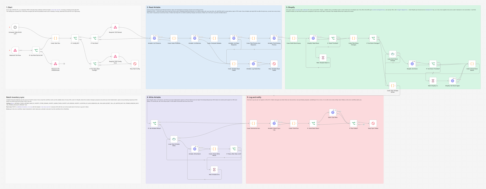
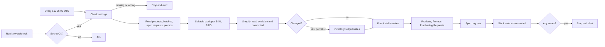

# Batch Inventory and Best-Before Tracking, Synced to Shopify

A daily n8n workflow that treats the Airtable production batches of Demo Chocolate Co. (a made-up chocolate shop) as the source of truth for stock. It works out how many bars of each SKU can still be sold, sets that number in Shopify only where it changed, proposes a promo for every batch that is getting close to its best before date, opens a purchasing request for every SKU that drops below its reorder point and writes one Sync Log row per run.



## The problem

Chocolate has a best before date, and every batch has its own. The kitchen knows exactly what it made, what is promised to subscription boxes and wholesale buyers and what has shipped, but that lives in Airtable, not in Shopify. So the shop keeps selling bars from a batch that should have been pulled two weeks before its date, short dated stock sits until it is too late to discount it, and nobody notices that a best seller is down to four bars until it is gone. Typing numbers into Shopify by hand does not keep up, and it overwrites sales that happened while you were typing.

## What this does

1. **Works out sellable stock per SKU** from the Production Batches table: only Released batches that were produced on or before today and have more than `SELL_BY_BUFFER_DAYS` (14) days left before their best before date count. Units left are made minus reserved minus sold.
2. **Keeps batches in FIFO order** (earliest best before first) and writes that order into the Sync Log, so the packing team knows which batch to ship first.
3. **Updates Shopify only where the number changed**, with one `inventorySetQuantities` call per SKU. Units already sold in Shopify orders that have not shipped yet are left out, so they are never sold twice.
4. **Protects Shopify from overwrites and double updates.** Every call carries the quantity Shopify showed a moment earlier (`changeFromQuantity`), so a sale that lands in between is not overwritten, and an idempotency key, so a retry can never apply the same change twice.
5. **Proposes one promo per short dated batch** (best before within `PROMO_WINDOW_DAYS`, 45 days), with a suggested discount, Status Proposed. A batch never gets a second promo, even when someone made one by hand.
6. **Opens one purchasing request per SKU below its reorder point**, with the suggested batch size and any batch already planned, and never a second one while a request for that SKU is still Open or Scheduled.
7. **Logs every run** in Sync Log (counts, what changed, what was held back, what needs fixing) and posts a Slack note when a person has something to do.
8. **Fails safely.** Wrong mappings and bad batch data are skipped and named, outages are retried and reported, and any run with an error ends in an alert through the shared error workflow.

## How it works



Airtable allows 5 requests per second per base. Every Airtable call waits 500 ms after the previous one, so even two runs at the same moment (a double click on Run Now, or Run Now during the 06:00 run) stay at 4 calls per second together, and every write carries at most 10 records (Airtable's limit). A run makes about ten Airtable calls, so the slower pace costs a few seconds. The Run Now webhook answers right away with 202 and the run id; the results land in the Sync Log and in Slack.

## Workflow at a glance

| Step | Nodes | What it does |
|---|---|---|
| 1 | Schedule: Daily 06:00 UTC, Webhook: Run Now, IF: Run Now Secret OK?, Respond: 401 Unauthorized | Starts the run every day, or on demand when the `X-Run-Now-Secret` header matches `RUN_NOW_SECRET`. With no secret configured, every Run Now call is refused |
| 2 | Code: Start Run, IF: Config OK?, IF: Run Now?, Respond: 202 Started, Respond: 500 Config Error, Stop: Bad Config | Checks every setting, makes the run id (the start time plus the n8n execution id, for example `inventory-2026-10-21T06:00:00Z-48213`) and answers a Run Now call |
| 3 | Airtable: List Products, Code: Index Products, Airtable: List Batches | Reads the Active products and the Released and Planned batches (paginated, only the fields it needs). A read that hits its page limit with records left is refused |
| 4 | Code: Compute Sellable | Sellable units per SKU in FIFO order, units held back by the sell-by buffer, promo and reorder candidates, and anything that looks wrong (an expired batch still marked Released, a Planned batch whose date has passed, more units reserved and sold than made, a batch without a product or without Quantity Made) |
| 5 | Airtable: List Open Requests, Code: Plan Promos And Requests, Airtable: Find Existing Promos | Skips SKUs with an Open or Scheduled request, and batches that already have a promo, by link or by name (case and spaces ignored) |
| 6 | Code: Build Stock Query, Shopify: Read Stock, IF: Read Throttled?, Wait: Shopify Read 2 s | One GraphQL query reads the location and, for every synced SKU, its inventory item with the `available` and `committed` quantities. A throttled read is sent once more after 2 seconds |
| 7 | Code: Plan Stock Changes, IF: No Stock Changes? | Target = sellable minus committed. Checks the item belongs to the same SKU, is tracked and is stocked at the location, then plans one change per SKU that differs |
| 8 | Loop: Each Stock Change, Shopify: Set Stock, IF: Set Stock Throttled?, Wait: Shopify 2 s, Shopify: Set Stock Again, Code: Check Stock Result | One `inventorySetQuantities` per SKU with `changeFromQuantity` and `@idempotent`. A throttled call, or one whose key is still being processed, is sent once more with the same key after 2 seconds. Every result, good or bad, is collected |
| 9 | Code: Plan Airtable Writes, IF: No Airtable Writes? | Products (the stock Shopify now shows), new Promos and new Purchasing Requests, in batches of 10 |
| 10 | Loop: Each Airtable Write, Airtable: Write Batch, Code: Check Write Result, IF: Retry After Rate Limit?, Wait: Airtable 30 s | One write per pass. A 429 waits the 30 seconds Airtable asks for and tries once more |
| 11 | Code: Summarize Run, Airtable: Upsert Sync Log, Code: Finish Run | The Sync Log row (upsert on Run ID) and the run status: Success, Partial or Failed |
| 12 | IF: Send Slack Note?, Slack: Ops Note, IF: Run Failed?, Stop: Sync Failed | The Slack note, then a Stop and Error when anything failed, so the error workflow alerts you |
| On error | Code: Airtable Read Failed, Airtable: Log Failed Run, Stop: Airtable Read Failed | A failed Airtable read stops the run before anything was changed, after leaving a Failed row in the Sync Log when Airtable takes it |

## The rules

| Rule | How it works |
|---|---|
| A batch counts as sellable | Status `Released`, `Produced On` on or before today, and more than `SELL_BY_BUFFER_DAYS` days left before `Best Before`. Planned, On Hold, Expired and Depleted batches never count |
| Units left in a batch | `Quantity Made - Quantity Reserved - Quantity Sold`, never below 0 (a batch with more reserved and sold than made counts as 0 and is flagged). An empty Reserved or Sold counts as 0; a batch without Quantity Made is skipped and flagged |
| Sellable stock of a SKU | The sum of its sellable batches, listed earliest best before first (FIFO) |
| What Shopify gets | `available` = sellable minus `committed` (units in Shopify orders that are placed but not fulfilled yet; Airtable counts a unit as sold when it ships). Only Active products with a Shopify Inventory Item ID are synced, so wholesale only and draft products keep whatever Shopify has |
| When Shopify is updated | Only when that number differs from what Shopify shows now. Airtable wins: a number typed into the Shopify admin is set back |
| Promo | A sellable batch with units left and at most `PROMO_WINDOW_DAYS` days to best before gets `PROMO-<batch code>`, Status Proposed, `PROMO_DISCOUNT_PERCENT` suggested. A person switches it on |
| Purchasing request | Sellable stock strictly below the product's Reorder Point opens `PR-<SKU>-<date>` with the Reorder Quantity as the suggested batch, unless the SKU already has a request that is Open or Scheduled (the kitchen has planned the batch but the stock is still low). Once a request is Received or Cancelled, a SKU that is still low gets a new one |
| Days | Every date rule works on UTC calendar days |

This is what the seed data gives on the test day (6 of the 21 Shopify SKUs change):

| SKU | Shopify before | Batches (FIFO) | Shopify after |
|---|---|---|---|
| DC-BAR-DARK-SEASALT | 180 | B-DSS-260523 30 (15 days left, promo already exists), B-DSS-260910 170 | 200 |
| DC-BAR-DARK-85 | 30 | B-D85-260403 held back (10 days left), B-D85-260821 4 | 4 |
| DC-BAR-DARK-ALMOND | 110 | B-DAL-260314 past its date but still Released (flagged, not counted), B-DAL-260920 80 | 80 |
| DC-BAR-WHITE-MATCHA | 20 | B-WMA-260612 40 (30 days left, new promo), B-WMA-261010 14 | 54 |
| DC-BAR-OAT-MILK | 80 | B-OAT-260915 160 made, 4 reserved, 81 sold | 75 |
| DC-BAR-MILK-CLASSIC | 200 | B-MCL-260920 190 | 190 |

It also creates the promos PROMO-B-WMA-260612, PROMO-B-PRB-260930 and PROMO-B-MSC-260722 (45 days, right on the edge; B-MHZ-260712 at 46 days gets none) and purchasing requests for DC-BAR-DARK-85, DC-BAR-DARK-CHILI and DC-PRALINE-HAZELNUT. DC-BAR-DARK-MINT is below its reorder point too, but it already has an Open request.

## What the team gets

A Slack note like this one, from the test run (all data made up):

```
*Inventory sync* inventory-2026-10-21T03:16:29Z-14064 (Run Now), Success
Shopify stock set for 6 SKUs at Demo Kitchen: DC-BAR-DARK-85 30 to 4, DC-BAR-DARK-ALMOND 110 to 80, DC-BAR-DARK-SEASALT 180 to 200, DC-BAR-MILK-CLASSIC 200 to 190, DC-BAR-OAT-MILK 80 to 75, DC-BAR-WHITE-MATCHA 20 to 54

*New promos (3)*, 25% off suggested, Status Proposed in Airtable:
• PROMO-B-WMA-260612 for DC-BAR-WHITE-MATCHA, 40 units, best before 2026-11-20 (30 days left)
• PROMO-B-PRB-260930 for DC-BOX-PRALINE-12, 38 units, best before 2026-11-30 (40 days left)
• PROMO-B-MSC-260722 for DC-BAR-MILK-CARAMEL, 50 units, best before 2026-12-05 (45 days left)

*New purchasing requests (3)*:
• DC-BAR-DARK-85, 4 sellable, reorder point 40, suggested batch 200
• DC-BAR-DARK-CHILI, 19 sellable, reorder point 30, suggested batch 150
• DC-PRALINE-HAZELNUT, 40 sellable, reorder point 200, suggested batch 1000

*Needs attention (1)*:
• Batch B-DAL-260314 (DC-BAR-DARK-ALMOND) is past its best before date (2026-10-16) but still marked Released, 20 units
```

The note only goes out when a person has something to do or know (a new promo, a new request, something to fix, an error). A run that only moved stock stays quiet; the Sync Log has it.

Every run that gets past the settings check writes a Sync Log row (unless Airtable itself is down or a read is cut short, see Failure handling) with Status (Success, Partial or Failed), Items Checked (Shopify SKUs compared), Items Changed and Shopify Updates (SKUs set in Shopify), Promos Created, Purchasing Requests Created, Errors and readable Details, including the FIFO batches behind every number:

```
Run Now run, started 2026-10-21T03:16:29.042Z.
Checked 21 Shopify SKUs at Demo Kitchen. 6 changed, 15 already correct.
Set in Shopify (FIFO batches in brackets): DC-BAR-DARK-85 30 to 4 [B-D85-260821 4]; DC-BAR-DARK-ALMOND 110 to 80 [B-DAL-260920 80]; DC-BAR-DARK-SEASALT 180 to 200 [B-DSS-260523 30, B-DSS-260910 170]; DC-BAR-MILK-CLASSIC 200 to 190 [B-MCL-260920 190]; DC-BAR-OAT-MILK 80 to 75 [B-OAT-260915 75]; DC-BAR-WHITE-MATCHA 20 to 54 [B-WMA-260612 40, B-WMA-261010 14].
Not on Shopify, Airtable only: DC-PRALINE-HAZELNUT.
Held back, inside the 14 day sell-by buffer: B-D85-260403 DC-BAR-DARK-85 30 units (10 days left).
Promos created (25% suggested): PROMO-B-WMA-260612, PROMO-B-PRB-260930, PROMO-B-MSC-260722.
Promos already there: PROMO-B-DSS-260523.
Purchasing requests created: DC-BAR-DARK-85, DC-BAR-DARK-CHILI, DC-PRALINE-HAZELNUT.
Purchasing requests already in progress: DC-BAR-DARK-MINT (Open).
Needs attention: Batch B-DAL-260314 (DC-BAR-DARK-ALMOND) is past its best before date (2026-10-16) but still marked Released, 20 units.
```

## Setup

**You need:** n8n (self-hosted, 2.x), the Demo Chocolate Co. base built with [setup/create_base.py](../../setup/create_base.py), a Shopify custom app with an Admin API access token, and optionally a Slack incoming webhook. The whole system setup is in [docs/setup.md](../../docs/setup.md).

1. Import [workflow/batch-inventory-sync.json](workflow/batch-inventory-sync.json) into n8n.
2. Import [shared/error-alert-slack.json](../../shared/error-alert-slack.json), **activate it**, and choose it as the **Error Workflow** in this workflow's settings. n8n 2.x skips an error workflow that is not active, so without this no alert arrives.
3. Add the variables below to your n8n environment and restart n8n. The nodes read them with `$env`, so self-hosted n8n needs `N8N_BLOCK_ENV_ACCESS_IN_NODE=false`. (n8n Cloud does not allow `$env`. There, replace `$env.` with `$vars.` and create the same names under Variables.)
4. Give the Shopify app the `write_inventory` scope (it includes reading inventory) and `read_locations`.
5. Activate the workflow. It runs every day at 06:00 UTC; change the time in the schedule node. To run it now: `POST https://YOUR-N8N-DOMAIN/webhook/inventory-run-now` with the header `X-Run-Now-Secret: <your RUN_NOW_SECRET>`.

| Variable | Required | What it is |
|---|---|---|
| `AIRTABLE_TOKEN` | yes | Airtable personal access token with `data.records:read` and `data.records:write` on the base |
| `AIRTABLE_BASE_ID` | yes | The base id from the base URL (`app` plus 14 characters) |
| `SHOPIFY_STORE_DOMAIN` | yes | `your-store.myshopify.com`, without `https://` |
| `SHOPIFY_ADMIN_TOKEN` | yes | The custom app's Admin API access token (`shpat_...`). It must be a token that does not expire, see [docs/setup.md](../../docs/setup.md) step 6 (client credentials tokens expire after 24 hours) |
| `SHOPIFY_API_VERSION` | no | Default `2026-10`. Must be 2026-04 or newer: the stock update uses `changeFromQuantity` and `@idempotent` |
| `SHOPIFY_LOCATION_ID` | yes | The location whose stock is set, for example `gid://shopify/Location/123456` (Settings > Locations, the number in the URL) |
| `SLACK_WEBHOOK_URL` | no | Slack incoming webhook for the ops note. Leave it empty to skip Slack. The error workflow uses the same variable |
| `RUN_NOW_SECRET` | for Run Now | Any long random string. Without it, every Run Now call gets 401 |
| `SELL_BY_BUFFER_DAYS` | no | Default 14. Batches with this many days or fewer before best before are not sold any more |
| `PROMO_WINDOW_DAYS` | no | Default 45. Must be larger than the buffer; 0 switches promos off |
| `PROMO_DISCOUNT_PERCENT` | no | Default 25. The discount written on new promos, a whole number from 1 to 90 |

## Testing

The workflow was tested end to end on n8n 2.19.5 against the repo's **strict mock Airtable, Shopify Admin GraphQL and Slack APIs** ([tests/mocks](../../tests/mocks)), so no real account was touched. The mocks reject what the real APIs reject: a sixth Airtable request inside one second (then 30 seconds of 429), more than 10 records per write, unknown fields, wrong types, an `inventorySetQuantities` call without `@idempotent` or `changeFromQuantity`, an inactive location, and so on.

All 71 checks pass: 23 scenarios run through n8n, plus static checks of the workflow file and a final count of the error alerts.

| Scenario | Result |
|---|---|
| Run Now without the secret, or with a wrong one | 401, nothing read or changed |
| Seeded run | 202 with the run id right away. One `inventorySetQuantities` per changed SKU (6) with the exact input and key; the 15 unchanged SKUs, DC-BAR-PUMPKIN-SPICE (40) and DC-BAR-GINGER (25) untouched in Shopify. 3 promos and 3 purchasing requests with exact fields, one Sync Log row, one Slack note. Airtable calls at least 500 ms apart (never more than 2 in any second), at most 10 records per write |
| Rerun right away | Shopify read once and not changed; no new promo, request or product write; a Sync Log row with zeros that names the 4 promos and 4 requests already there |
| Stock changed in Shopify and in Airtable | 300 typed into the Shopify admin is set back to 290; a batch put On Hold takes its SKU to 0 and opens a request; 5 units in an unshipped order stay off sale; a Scheduled request blocks a new one |
| A sale lands during the run | Shopify refuses the stale change and the sale is kept; the other SKU is set; Partial and an alert. The next run sets the SKU with fresh numbers and a new key |
| Mapping mistakes (another product's item, an untracked item, an unknown id, a malformed id) | All 4 SKUs skipped and named in Slack; no product ever gets another product's numbers |
| Shopify applies a change but the answer is lost | n8n retries with the same key and input, Shopify replays, the change is applied once |
| Shopify throttles the read and one update, and finds one key still in progress | Each is sent once more after 2 seconds with the same key and input; every change applied once, Success, no alert |
| Shopify throttles twice | An update: that SKU keeps its old stock, the other 5 are set, Partial and an alert. The read: nothing set, Failed and an alert |
| Shopify is down | 3 tries, nothing set in Shopify or Products, promos and requests still created, Failed and an alert |
| Airtable answers 429 on a write | 3 tries, a 30 second wait, the 4th try saves, no duplicates |
| An Airtable write fails | Partial and an alert naming the table and the Airtable error; the next run corrects Products without touching Shopify |
| Airtable is down at the start | Stops before anything changes and leaves a Failed Sync Log row; the alert names the read and the error. With all of Airtable down, the alert also says the row could not be saved |
| A promo made by hand (lower case, a trailing space, no batch link) | Found by name and left as it was, no duplicate |
| More than 10 changes | 18 SKUs set in Shopify, Products written in 2 calls (10 + 8), still paced |
| Batch data mistakes (a Planned batch past its date, more reserved and sold than made, a future Produced On, no product, no Quantity Made) | Each named in Slack, none of their units counted, the stock result unchanged |
| Slack is down | 3 tries; the stock, promos, requests and Sync Log are saved, the run ends failed and the error workflow alerts |
| A scheduled run | Runs as Trigger Schedule with no webhook answer, same result as Run Now |
| Two Run Now calls at once (rate limiter on) | No 429; two Sync Log rows; each change applied once in Shopify (the run that lost a SKU to the other says Partial and alerts); no duplicate promo or request, each counted as created once |
| Bad settings | 500 with the exact list of problems, no API call, an alert |
| Reads that need several pages | 22 products and 30 batches read 10 per page, same result as one page |
| A read cut short by its page limit | Refused before anything changes, an alert |
| A closed Shopify location | No stock set, Products untouched, Failed and an alert |
| Error alerts | Exactly one alert per failed run (8), none for the 14 runs that succeeded |

The tests caught real bugs before release. The pagination option was nested one level too shallow, so n8n ignored it and read only the first 100 records of each table; every seeded table fits in one page, so only a test with small pages showed it. A review then found that a request the kitchen had marked Scheduled let the next run open a duplicate every day, that two runs at once (a double click) hit Airtable's rate limit and both stopped, and shared one Sync Log row when they started in the same second, and that a throttled Shopify call failed the SKU instead of being sent again. All of these are fixed and covered by the scenarios above.

Full output, the requests the workflow sent and the alerts: [docs/test-report.md](docs/test-report.md). Run it yourself with [tests/e2e_mock_test.py](tests/e2e_mock_test.py).

## Failure handling

| What goes wrong | What happens |
|---|---|
| Wrong or missing `X-Run-Now-Secret` | 401, nothing is read or changed |
| A setting is missing or wrong | A Run Now call gets 500 with the list of problems; the run stops at Stop: Bad Config and the alert lists them. No Sync Log row, because the Airtable settings may be the problem |
| An Airtable read fails (after 3 tries) | Stop: Airtable Read Failed before anything was changed. A Failed Sync Log row is written first when Airtable takes it (a renamed field gives 422, and the write still works); the alert names the read and the Airtable error, and says so when the row could not be saved either |
| A read reaches its page limit (100 pages of 100 records) with records left | The run stops before anything changes instead of working with part of a table, and the alert says which read to raise. No Sync Log row |
| Shopify is down, the token is wrong, or the location is not active | No stock is set and Products is not touched. Promos and purchasing requests are still written (they only need Airtable). Sync Log says Failed, the alert explains why |
| Shopify throttles a call (`THROTTLED`), or finds its idempotency key still being processed (`IDEMPOTENCY_CONCURRENT_REQUEST`) | Nothing was applied, so the call is sent once more after 2 seconds with the same key. If that fails too, the read fails the run (Failed) or that one SKU keeps its old number (Partial), and the next run catches up |
| A sale lands between the read and the write | Shopify refuses the change (`CHANGE_FROM_QUANTITY_STALE`), the sale is kept, the other SKUs still sync. Sync Log says Partial, Slack and the alert name the SKU, the next run sets it with fresh numbers |
| Shopify applied a change but the answer got lost | n8n retries with the same idempotency key and input, Shopify replays its first answer, the change is applied once |
| Shopify refuses an update for another reason | That SKU keeps its old number in Shopify and in Airtable, the others still sync, Sync Log says Partial, the alert has Shopify's error code |
| Two runs at the same time (a double click on Run Now) | Each gets its own Sync Log row. A SKU is set by whichever run gets there first; the other run gets `CHANGE_FROM_QUANTITY_STALE` for it, says Partial and alerts. Promos and requests are upserts, so nothing is created twice |
| Airtable answers 429 on a write | Three tries, then a 30 second wait (Airtable's penalty) and one more try. Upserts and updates by record id never create duplicates when repeated |
| An Airtable write fails for good | The Shopify part is done; Sync Log says Partial and you get an alert. The next run sees Shopify already right, corrects Shopify Stock in Products and creates any promo or request that was not saved |
| A product maps to the wrong Shopify item, an item that is not tracked or not stocked at the location, or an id that does not exist | That SKU is skipped and named in the Slack note. Another product's numbers are never pushed |
| A batch is past its best before date but still marked Released | Not counted, flagged in Slack every day until someone changes its status (the kitchen owns batch status, the sync never changes it) |
| Other batch data mistakes: a Planned batch whose Produced On date has passed, a Released batch dated in the future, more units reserved and sold than made, no product link, no Quantity Made | Not counted (or counted as 0) and flagged in Slack, so the kitchen can fix the record |
| Slack fails (after 3 tries) | Everything else is already saved, Sync Log included. The run ends at Stop: Sync Failed, so it shows as failed in n8n and the error workflow alerts you |

## Limitations and next steps

- One Shopify location (`SHOPIFY_LOCATION_ID`). Several warehouses would need a location per batch.
- Up to 250 synced SKUs per run, the most one `nodes(ids:)` query reads. A bigger catalog needs the read split into pages.
- The 5 requests per second limit is per base and shared with the other automations on this base. Each workflow paces itself, but they do not coordinate, so a busy moment can still produce a 429. Writes wait and retry; a failed read simply stops the run before anything changed, and the next run (or Run Now) catches up. Two runs of this workflow together stay at 4 calls per second, which leaves room for one more call, not for another busy automation.
- The `committed` subtraction assumes Quantity Sold goes up when an order ships, as the field description says. If your team counts a unit as sold when the order is placed, remove the subtraction in Code: Plan Stock Changes, or units would be taken off twice.
- Other Shopify holds (`reserved`, `safety_stock`, `damaged`, `quality_control`) are not subtracted, because Airtable is where this shop sets stock aside (Quantity Reserved). If you use those states in Shopify, read them in Code: Build Stock Query and subtract them next to `committed` in Code: Plan Stock Changes.
- Promos are proposals. Switching one on in Shopify (an automatic discount) is a person's job; creating the discount when the Status turns Active would be the natural next step.
- Stock Synced At moves only when the sync pushed a number to Shopify. A correction of Shopify Stock in Airtable alone leaves it as it was.
- A request is named `PR-<SKU>-<date>`. If a person closes a request and the SKU is still low on the same day, the new one gets the same name (the upsert key is SKU plus Status, so this does not break anything).
- A Planned batch never stops a purchasing request: DC-PRALINE-HAZELNUT gets one even though 1500 units are planned in 3 days, and the request names the planned batch so the kitchen can decide. Counting planned units against the reorder point would be a one line change in Code: Compute Sellable.
- API keys are read from environment variables. For production, move them into n8n credentials.

## About

Built by **Romiel Inolino**, AI and CRM Automation Specialist working with GoHighLevel, Monday.com, ClickUp, n8n, Make and Zapier.
Portfolio and case studies: [romielwillautomate.dev](https://romielwillautomate.dev)

This repository is a portfolio implementation. Credentials, API keys and customer data are not included, and all test data is made up.
