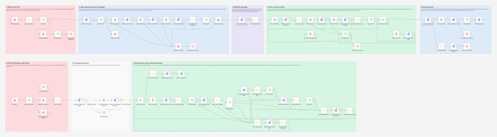
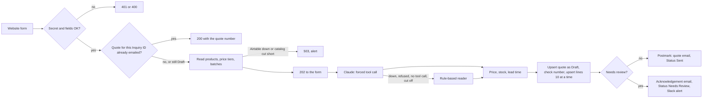
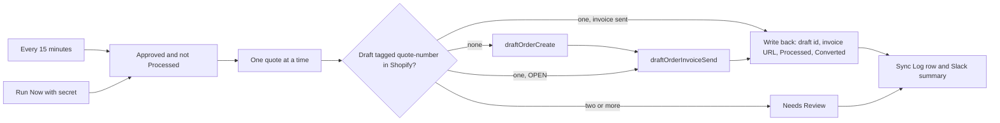

# Wholesale Inquiry to Quote to Shopify Draft Order

An n8n workflow for Demo Chocolate Co. (a made-up chocolate shop). A wholesale buyer writes a free text message on the website form, like "120 dark sea salt bars and 60 hazelnut pralines for our cafe, need them by March 3". Claude reads it, the Airtable price list prices it, stock and production capacity decide whether the date can be met, and the buyer gets a quote by email with a quote number. When someone sets the quote to Approved in Airtable, the workflow turns it into a Shopify draft order, sends the Shopify invoice and writes the draft order and invoice link back to the quote, exactly once.



## The problem

Wholesale inquiries arrive as messages, not orders. Someone has to read each one, work out which products the buyer means, look up the right price tier for the quantity, check whether there is enough stock or whether the kitchen can make it in time, type a quote, and later, when the buyer says yes, build the same order again in Shopify and send an invoice. Each step is a chance to quote the old price, miss a product nobody sells, promise a date the kitchen cannot meet, or invoice the same quote twice.

## What this does

1. **Takes the website form safely.** The form's server posts each inquiry with a shared secret in the `X-Form-Secret` header. A wrong secret gets 401, bad fields get 400 with every problem listed, and a repeat post of a submission whose quote was already emailed gets 200 with its quote number. A quote that an earlier run left unfinished (still Draft) is finished by the repost instead, with the same number. The form gets its answer (202) in about a second, before Claude is asked anything.
2. **Reads the message with Claude** through a forced tool call. Claude can only pick SKUs that exist in the Airtable catalog (an `enum` in a strict tool schema), returns business name, contact, phone, needed-by date, one line per product and any special request. It never sets a price.
3. **Falls back to rule-based reading** when Claude is down, refuses, answers without the tool call or is cut off at `max_tokens` (a cut-off tool input is never used). The fallback reads quantities (including "2 dozen" and "1,200"), product words, dates such as "March 3", "12/01" or "2026-11-15" and a phone number, and the quote always goes to a person.
4. **Prices every line from the Price List**: the active tier of the matched product whose Min and Max Quantity cover the quantity. The same product asked for twice is one line, so the tier fits the total. The inactive old tier is never used.
5. **Checks feasibility** against stock and production: sellable stock (the same rule as the inventory sync), then planned batches, then new production at the product's Daily Capacity plus its Production Lead Days, plus 2 shipping days. The quote is In Stock, Feasible With Production, Not Feasible (with the earliest arrival) or Unknown.
6. **Saves the quote and its lines** in Airtable (Quotes upserted on Inquiry ID, Quote Lines on Line Label), so running the save again never duplicates anything. The quote is saved as Draft. The lines go 10 per request, one request at a time, so every request gets its own retries and the email waits until every line is saved. A product that matches nothing, a retail-only product, a quantity below the wholesale minimum, an unclear quantity, a special request or a date that cannot be met is written as a review reason, and the line keeps no made-up price.
7. **Emails the quote** through Postmark (HTML and plain text, quote number in the subject), marks it Sent and keeps the Postmark message id. A quote that needs review gets a short acknowledgement email instead, Status Needs Review, and the team gets a Slack alert with the reasons. The same status write links the quote to exactly the lines in its email.
8. **Turns approved quotes into Shopify draft orders** every 15 minutes (or on demand with Run Now): `draftOrderCreate` with the buyer's email, a note, the tags `wholesale` and `quote-<number>` and the quoted prices, then `draftOrderInvoiceSend`. The draft order id, its name and the invoice URL go back to the quote, with Processed ticked and Status Converted.
9. **Never converts a quote twice.** Shopify gives `draftOrderCreate` no idempotency key, so every pass first looks for a draft order already tagged `quote-<number>` and carries on from there: create, only send the invoice, or only update Airtable.
10. **Fails safely.** Outages are retried, then reported; an inquiry is never lost silently and an approved quote stays Approved until it really is converted. A quote that cannot be converted is listed in the run's Slack summary with the reason, and a run that has to stop ends in an alert through the shared error workflow.

## How it works





Airtable allows 5 requests per second per base, so every Airtable call in a run waits at least 250 ms after the one before it (the test measured at most 4 in any second), and every write carries at most 10 records.

## Workflow at a glance

| Step | Nodes | What it does |
|---|---|---|
| 1 | Wholesale Inquiry, Code: Check Form, Form OK?, Respond: Rejected, Config Problem?, Stop: Form Not Configured | Checks the secret (compared in constant time) and the fields. With no `WHOLESALE_FORM_SECRET` set, every post gets 500 and the team an alert |
| 2 | Airtable: Find Inquiry, New Inquiry?, Respond: Duplicate | A quote for this Inquiry ID with any Status other than Draft means a repeat post: 200 with its number. A Draft quote was left half way by an earlier run, so this post finishes it with the same number |
| 3 | Wait: Pace Products, Airtable: Load Products, Wait: Pace Price List, Airtable: Load Price List, Wait: Pace Batches, Airtable: Load Batches | Active products, active price tiers, Released and Planned batches, every page, about 300 ms apart |
| 4 | Code: Build Claude Request, Catalog OK?, Respond: Received, Respond: Try Again, Stop: Inquiry Not Taken | Builds the request from the catalog. An empty catalog, a read cut short by its page limit or an Airtable outage gets the form a 503 (post again later) and the team an alert; otherwise the form gets 202 |
| 5 | Claude: Extract Inquiry, Code: Read Extraction | One Claude call (3 tries). Checks the tool call and every field; anything wrong switches to the rule-based reader |
| 6 | Wait: Airtable Pace, Airtable: Last Quote Number, Code: Price Quote | The next quote number of the year, the prices, the feasibility, the review reasons and both emails |
| 7 | Wait: Pace Save, Airtable: Upsert Quote, Wait: Pace Check, Airtable: Check Quote Number, Code: Build Quote Lines, Number Free?, Loop Over Line Batches, Wait: Pace Lines, Airtable: Upsert Quote Lines | Saves the quote as Draft, makes sure no other quote holds the same number (if one does, this quote takes the next number before any line is written), then upserts the lines 10 at a time, one request per pass of the loop, so each request has its own 3 tries |
| 8 | Airtable Busy?, Wait: Airtable Cooldown, Stop: Quote Not Saved | A 429 waits 31 seconds (Airtable blocks the base for 30) and runs the save again, at most twice. Any other failure stops with an alert; the form can post again and the quote keeps its number |
| 9 | Postmark: Email Buyer, Wait: Pace Mark, Airtable: Mark Email Sent, Needs Review?, Stop: Sent Not Recorded, Slack: Review Alert | The quote email and Status Sent, or the acknowledgement, Status Needs Review and the Slack review alert. The status write also sets the quote's Quote Lines to exactly the lines in the email |
| 10 | Code: Email Failed, Airtable: Flag Email Failure, Stop: Email Not Sent | A refused email (a bounced address, for example) marks the quote Needs Review with Postmark's reason and raises an alert |
| 11 | Every 15 Minutes, Run Now, Run Now Allowed?, Respond: Run Started, Respond: Run Now Refused, Code: Start Poll | Starts the approval check. Run Now needs the `X-Run-Now-Secret` header and answers 202 before the work starts |
| 12 | Airtable: List Approved Quotes, Code: Plan Quotes, Wait: Pace Shopify Products, Airtable: Load Shopify Products, Code: Split Quotes, Stop: Poll Failed | `AND({Status} = 'Approved', NOT({Processed}))`, every page. No approved quote: the run ends without writing anything |
| 13 | Loop Over Quotes, Wait: Pace Quote, Airtable: Get Quote Lines, Code: Build Draft Order, Draft Input OK? | One quote per pass. Every line must be Matched with a product, a quantity and a unit price, and every linked line must come back |
| 14 | Shopify: Find Existing Draft, Code: Choose Action, Switch: Action | Looks up drafts tagged `quote-<number>` (exact tag) and the Shopify customer with the same email |
| 15 | Shopify: Create Draft Order, Code: Read Created Draft, Draft Created?, Shopify: Send Invoice, Code: Read Invoice, Invoice Sent? | `draftOrderCreate` and `draftOrderInvoiceSend`, each checked for GraphQL errors and userErrors (Shopify answers those with HTTP 200) |
| 16 | Code: Build Write Back, Airtable: Mark Quote Converted, Code: Quote Converted | Draft Order ID, Draft Order Name, Invoice URL, Invoice Sent At, Processed At, Processed, Status Converted |
| 17 | Code: Quote Failed, Airtable: Record Quote Error, Code: Quote Not Converted | A problem with the quote sends it to Needs Review; an API problem keeps it Approved with the error in Processing Error, for the next run |
| 18 | Code: Summarize Run, Airtable: Write Sync Log, Slack: Poll Summary | One Sync Log row (Success, Partial or Failed) and one Slack summary per run that found approved quotes |

## The rules

| Rule | How it works |
|---|---|
| Product match | Claude picks a catalog SKU or an empty string; anything outside the catalog becomes "no match". A match Claude marks as low confidence is priced but goes to review |
| Price | The active tier of that product with Min Quantity <= quantity <= Max Quantity (an empty Max has no upper limit). Products that are not Wholesale Available or have no tier are No Tier |
| Sellable stock | Batches with Status Released, Produced On on or before today and more than `SELL_BY_BUFFER_DAYS` (14) days before Best Before. Units = Made minus Reserved minus Sold, never below 0 |
| Ready date of a line | Today when stock covers it. Otherwise planned batches first (each ready Production Lead Days after it starts), then new production at Daily Capacity a day from tomorrow, then Production Lead Days |
| Feasibility | Earliest arrival = the latest ready date plus 2 shipping days (`SHIPPING_DAYS` in Code: Price Quote). Later than Needed By is Not Feasible and goes to review |
| Needs review | Any of: the rule-based reader was used, an unmatched product, an unclear quantity, a quantity above 20,000, a low confidence match, No Tier, below the wholesale minimum, more than 25 products, a special request, a needed-by date that is unreadable or in the past, Not Feasible, or a ready date that cannot be worked out |
| Quote number | `Q-<year>-<4 digits>`, the next after the highest of the year. A quote keeps its number when its save is repeated |
| Valid until | Today plus `QUOTE_VALID_DAYS` (14) |
| Draft order lines | A product with a Shopify variant keeps the variant (so Shopify stock and reports stay right) with the quoted price as `priceOverride`. A wholesale-only product with no variant becomes a custom line with its title, SKU and `originalUnitPriceWithCurrency` |
| Discounts | A Total lowered by hand in Airtable becomes a fixed `appliedDiscount` for the difference. A Total above the lines, or a Total of 0, goes to review. Automatic discounts are switched off on the draft order |
| Customer | When a Shopify customer has the quote's email, the draft order is attached to them (`purchasingEntity`); otherwise Shopify uses the email alone |

With the seed data, the example message prices exactly like this (Q-2026-0046):

| Line | Tier | Price | Total | Stock | Delivery |
|---|---|---|---|---|---|
| 120 x DC-BAR-DARK-SEASALT | 100-299 | 4.20 | 504.00 | 200 in stock | in stock |
| 60 x DC-PRALINE-HAZELNUT | 50-199 | 1.10 | 66.00 | 40 in stock | 20 from planned batch B-PRL-261023, ready to ship 2 days after it starts |

Subtotal 570.00, Feasible With Production. The praline is wholesale only and not on Shopify, so it becomes a custom line on the draft order.

## What the buyer and the team get

The quote email, from the test run (all data made up):

```
Demo Chocolate Co. wholesale quote Q-2026-0046

Hello June,

Thank you for your wholesale inquiry for Bluebird Cafe. Here is your quote. It is valid until November 4, 2026.

120 x Dark 70% Sea Salt Bar (DC-BAR-DARK-SEASALT) at $4.20 = $504.00, in stock
60 x Hazelnut Praline, single piece (wholesale) (DC-PRALINE-HAZELNUT) at $1.10 = $66.00, ready to ship October 26, 2026

Total (USD): $570.00

Earliest delivery: about October 28, 2026. You asked for March 3, 2027.

To place the order, reply to this email and say you approve quote Q-2026-0046. We will then send you an invoice that you can pay online.
Prices are per unit in US dollars. Sales tax, if any, is added on the invoice.
```

The HTML version has the same content as a table. A quote that needs review gets a Slack alert like this one:

```
:mag: *Wholesale quote needs review*: Q-2026-0049
Corner &lt;Shop&gt; &amp; Co, Lee Park, corner.shop@example.com, read by Claude
*Why*
• 10 x DC-BAR-DARK-SEASALT is below the wholesale minimum of 24.
• DC-BAR-DARK-ORANGE is not on the wholesale price list.
• The buyer also asked: Asks for 50% off the whole order. &lt;!channel&gt;
*Lines*
• 10 x "sea salt bars" (DC-BAR-DARK-SEASALT), no tier
• 50 x "dark orange bars" (DC-BAR-DARK-ORANGE), no tier
Feasibility: In Stock. The buyer got an acknowledgement email. Fix the quote in Airtable, then send it.
```

Buyer text is escaped, so `<!channel>` in a message cannot ping anyone. After each approval run with approved quotes, the team gets a summary:

```
:warning: *Wholesale quotes* (Run Now): 2 converted, 2 need review, 0 to retry
• Q-2026-0046 Bluebird Cafe: draft order #D2 created, invoice sent to june.park@example.com
• Q-2026-0091 Maple Grocer: draft order #D3 created, invoice sent to maya.chen@example.com
• Q-2026-0092 Rose Garden: needs review. Q-2026-0092 / 1 is Unmatched.
• Q-2026-0093 Caramel Club: needs review. Shopify refused the draft order (lineItems.0.variantId Product with ID gid://shopify/ProductVariant/4519999999999 is no longer available.).
```

## Setup

**You need:** n8n (self-hosted, 2.x) reachable over HTTPS from your website's server, the Demo Chocolate Co. base built with [setup/create_base.py](../../setup/create_base.py), a Shopify custom app with an Admin API access token, an Anthropic API key, a Postmark server with a confirmed sender signature for your wholesale address, and a Slack incoming webhook. The whole system setup is in [docs/setup.md](../../docs/setup.md).

1. Import [workflow/wholesale-quote-to-draft-order.json](workflow/wholesale-quote-to-draft-order.json) into n8n.
2. Import [shared/error-alert-slack.json](../../shared/error-alert-slack.json), **activate it**, and choose it as the **Error Workflow** in this workflow's settings. n8n 2.x skips an error workflow that is not active, so without this no alert arrives.
3. Add the variables below to your n8n environment and restart n8n. The nodes read them with `$env`, so self-hosted n8n needs `N8N_BLOCK_ENV_ACCESS_IN_NODE=false`. (n8n Cloud does not allow `$env`. There, replace `$env.` with `$vars.` and create the same names under Variables.)
4. Give the Shopify app the `write_draft_orders` scope (it includes reading draft orders) and `read_customers`.
5. Activate the workflow.
6. Have your website's server (not the browser, so the secret stays private) post each form submission to `https://YOUR-N8N-DOMAIN/webhook/wholesale-inquiry` with the header `X-Form-Secret: <your WHOLESALE_FORM_SECRET>` and a JSON body:

   ```json
   {"submissionId": "form-7f3a91", "email": "buyer@example.com", "name": "June Park", "company": "Bluebird Cafe",
    "phone": "+1 555 010 1031", "message": "120 dark sea salt bars and 60 hazelnut pralines for our cafe, need them by March 3"}
   ```

   `submissionId` (letters, digits and `. _ : -`, at most 64 characters), `email` and `message` (at most 5,000 characters) are required. Send the same `submissionId` again when you retry a post, so it never becomes two quotes. Post again on a 503.
7. To convert approved quotes now instead of waiting up to 15 minutes: `POST https://YOUR-N8N-DOMAIN/webhook/wholesale-run-now` with the header `X-Run-Now-Secret: <your RUN_NOW_SECRET>`.

| Variable | Required | What it is |
|---|---|---|
| `AIRTABLE_TOKEN` | yes | Airtable personal access token with `data.records:read` and `data.records:write` on the base |
| `AIRTABLE_BASE_ID` | yes | The base id from the base URL (`app` plus 14 characters) |
| `SHOPIFY_STORE_DOMAIN` | yes | `your-store.myshopify.com`, without `https://` |
| `SHOPIFY_ADMIN_TOKEN` | yes | The custom app's Admin API access token (`shpat_...`). It must be a token that does not expire, see [docs/setup.md](../../docs/setup.md) step 6 (client credentials tokens expire after 24 hours) |
| `SHOPIFY_API_VERSION` | no | Default `2026-10` |
| `ANTHROPIC_API_KEY` | yes | console.anthropic.com, API keys |
| `ANTHROPIC_MODEL` | no | Default `claude-sonnet-5`. The request uses a forced tool call, which `claude-opus-5-5` and `claude-fable-5-1` refuse with a 400, so every inquiry would fall back to the rule-based reader on those. `claude-haiku-4-5` also passes the request check |
| `POSTMARK_SERVER_TOKEN` | yes | Postmark, Servers, your server, API Tokens |
| `POSTMARK_MESSAGE_STREAM` | no | Default `outbound` (transactional) |
| `EMAIL_FROM_WHOLESALE` | yes | The From address, a confirmed Postmark sender signature, for example `Demo Chocolate Wholesale <wholesale@example.com>`. Buyers reply to it to approve |
| `SLACK_WEBHOOK_URL` | yes | Slack incoming webhook for review alerts and run summaries. The error workflow uses the same variable |
| `WHOLESALE_FORM_SECRET` | yes | Any long random string, shared with your website's server. Without it every form post gets 500 |
| `RUN_NOW_SECRET` | for Run Now | Any long random string. Without it every Run Now call gets 401 |
| `SELL_BY_BUFFER_DAYS` | no | Default 14, the same rule as the inventory sync |
| `QUOTE_VALID_DAYS` | no | Default 14 |

To change the shipping days or the largest quantity quoted without review, edit `SHIPPING_DAYS` and `MAX_QUANTITY` at the top of Code: Price Quote. The email wording is in the same node.

## Testing

The workflow was tested end to end on n8n 2.19.5 against the repo's **strict mock Airtable, Shopify Admin GraphQL, Claude, Postmark and Slack APIs** ([tests/mocks](../../tests/mocks)), so no real account was touched. The mocks reject what the real APIs reject: a sixth Airtable request inside one second (then 30 seconds of 429), more than 10 records per write, unknown fields, wrong types, an unknown select option, a bad formula, an unknown GraphQL field or argument, a Claude request with sampling parameters or a prefill, an email from an unconfirmed sender, and so on. The Claude request was also checked against Anthropic's real token counting endpoint, which validates the model, tools and forced tool choice without generating anything (`claude-sonnet-5`: 200, 2,891 input tokens).

All 100 checks pass: 35 scenarios run through n8n, plus static checks of the workflow file and checks over the whole run.

| Scenario | Result |
|---|---|
| Form post without the secret, or with a wrong one | 401, no API called |
| Invalid fields (a submission id with a quote in it, a bad email, no message) | 400 listing all three problems, no API called |
| The example inquiry | 202 in about 1 second. Q-2026-0046: 120 x DC-BAR-DARK-SEASALT at 4.20 = 504.00 and 60 x DC-PRALINE-HAZELNUT at 1.10 = 66.00, subtotal 570.00, Feasible With Production, Status Sent, one email, the Postmark message id stored. One Claude call, forced strict tool, 22 Active SKUs in the enum. 6 Airtable reads and 3 writes, never more than 4 in a second |
| The same form posted again | 200 with Q-2026-0046; no Claude call, no new quote, no email |
| Claude down (529) | 3 tries, then the rule-based reader prices the same 570.00, Needs Review with the reason, acknowledgement email and Slack alert |
| Claude refuses; Claude answers without the tool call | The rule-based reader takes over and the reason names what happened. A harder message reads as 24 tins ("2 dozen"), 48 bars and 1,200 pralines, a US date and a phone number |
| An unknown product | One Unmatched line, nothing priced, Feasibility Unknown, Needs Review |
| Below the wholesale minimum, a retail-only product and "50% off" with `<!channel>` | Three review reasons, no made-up price, the text escaped in the email and in Slack |
| Needed by tomorrow, 900 bars | Not Feasible with the earliest arrival; the active 300+ tier at 3.90, never the inactive 3.60 |
| Twelve products | 12 lines written in two upserts of 10 and 2; 8 priced (835.60), 4 retail-only named in the reasons |
| The quote email bounces | 3 tries, the quote kept and flagged with Postmark's reason, an alert |
| Airtable down at the start | 503 to the form, nothing else called, an alert naming the inquiry |
| Airtable 429 while saving | 3 tries, a 31 second wait, saved once with the same number, one email |
| Lines not saved, then the form posts again | 3 tries, no email, the quote stays Draft and the alert says to post again; the repost finishes the same quote: one quote, one line, one email |
| Twelve products, and the second line write (lines 11 and 12) fails | That write alone is tried 3 times, no email goes out, the quote stays Draft. The repost, read as 3 products this time, is finished with the same number and links exactly those 3 lines; lines 4 to 10 from the stopped run are unlinked |
| Twelve products, and the second line write gets 429 | 3 tries, the 31 second cooldown, then the whole save again (10 lines, then 2): 12 lines, one email |
| The quote email goes out but its status write fails | 3 tries, Stop: Sent Not Recorded with the alert text to set Sent by hand; a repost before that sends the same quote again, as the alert says |
| Slack down when a quote needs review | The quote is already Needs Review and the buyer has the acknowledgement; the run fails and the error workflow alerts |
| The same product asked for twice, one match unsure | One line of 120 on the 100-299 tier (4.20, not the 4.50 each half would get), sent to review to check the match |
| Claude stops at `max_tokens` in the middle of the tool call | The cut-off input (900 bars) is never used; the rule-based reader reads 36 bars and the quote goes to review |
| Two inquiries take the same number at once | The first keeps Q-2026-0054, this one moves to Q-2026-0055 before writing lines; the other quote's line untouched |
| Run Now with a wrong secret | 401, nothing read |
| Approved quote Q-2026-0042 | `draftOrderCreate` with the exact input, `draftOrderInvoiceSend`, the quote Converted and Processed with the draft id, name and invoice URL, one Sync Log row, one Slack summary. Q-2026-0043 (already processed) untouched |
| The next run | Finds nothing: no Shopify call, no Sync Log row, no Slack message |
| Four approved quotes at once | A custom line for the wholesale-only praline; a lowered Total becomes a 16.00 discount and the existing Shopify customer is attached; an unmatched line and a variant Shopify refuses both go to Needs Review. Sync Log Partial |
| Shopify down; Shopify throttled | The quote stays Approved with the error; the next run converts it |
| The invoice fails after the draft was created | The draft id is kept; the next run sends only the invoice (one draft, one invoice) |
| Airtable fails after Shopify finished | The next run creates nothing and sends no second invoice; Airtable catches up |
| Two drafts already tagged for one quote | Nothing created or invoiced, Needs Review naming both drafts |
| Approved quotes with a Total above the lines, a Total of 0, a Discontinued product, a bad email | Each back to Needs Review with its own reason; Shopify never called; Sync Log Failed with 4 errors |
| Secrets not set | The form gets 500 and an alert; Run Now refuses even an empty header |
| Every read over several pages (5 records a page) | 5, 4 and 6 pages for products, tiers and batches, the same quote as with one page; 3 approved quotes over 2 pages all converted |
| A read cut short by its page limit | The inquiry gets 503 and the alert names the read to raise; Run Now converts nothing and fails with an alert |
| Whole test | No real 429, no write above 10 records, no request to an unmocked URL, no Claude request refused |

The tests caught real bugs before release. The pagination option of every Airtable read was nested one level too shallow, so n8n read only the first page of each table. Every seeded table fits in one page, so only a test with small pages showed it. A later review found a second one: the quote lines were written by one HTTP node holding all the batches, and n8n retries such a node only when its first item fails. When the second write of a 12-line quote failed, it was not retried, the email still went out, and the repost was answered as a duplicate, so two lines were lost for good. The lines now go one write per pass of a loop, the email waits for all of them, and a quote counts as taken only once its email is recorded. The test was run against the old workflow too: 22 of its checks fail there, including every new line-write scenario.

Full output, the requests the workflow sent and what the tests found: [docs/test-report.md](docs/test-report.md). Run it yourself with [tests/e2e_mock_test.py](tests/e2e_mock_test.py).

## Failure handling

| What goes wrong | What happens |
|---|---|
| Wrong or missing `X-Form-Secret` | 401, nothing is read, no alert (so a bot cannot flood the alerts) |
| `WHOLESALE_FORM_SECRET` is not set | Every post gets 500 and the team an alert (fails closed) |
| Bad form fields | 400 with every problem listed; the submission id never reaches an Airtable formula unless it is plain letters, digits and `. _ : -` |
| The same submission posted again | Once its email went out: 200 with the existing quote number, no Claude call, no email. If an earlier run stopped before that (the quote is still Draft), the repost finishes the quote with the same number |
| Airtable down or a read cut short before the quote is taken | The form gets 503 and posts again later; the alert names the inquiry and the reason |
| Claude down (after 3 tries), refusing, cut off at `max_tokens`, or answering without the tool call or with missing fields | The rule-based reader fills in the quote, which goes to review with the reason; the buyer gets an acknowledgement |
| Airtable answers 429 while saving | n8n retries 3 times, then the workflow waits 31 seconds and repeats the save (at most twice). Upserts mean no duplicates and the same quote number |
| Airtable fails while saving for another reason | Stop: Quote Not Saved with an alert, and no email goes out. The quote stays Draft. The form already got 202, so post it again: the quote keeps its number and nothing is duplicated |
| One of several line writes fails (lines 11 and 12, say, after 1 to 10 were saved) | That write gets its own 3 tries; the email waits. A 429 goes through the 31 second cooldown and the whole save runs again; any other error stops with an alert. On the repost, the status write links the quote to exactly the lines in its email, so a line left from the stopped run never reaches a draft order |
| Two inquiries take the same quote number at the same moment | The one saved first keeps it; the other takes the next free number before writing any line |
| The quote email is refused (a bounced address, for example) or Postmark is down | 3 tries, then the quote is marked Needs Review with Postmark's reason and the run fails with an alert |
| The email went out but Airtable did not record it | Stop: Sent Not Recorded with an alert to set the Status by hand. Until then the quote is still Draft, so a repost of the form would send the email again |
| An approved quote has an unmatched line, no price, a non Active product, a bad email, missing lines, a Total above its lines or a Total of 0 | Needs Review with the reason; nothing is sent to Shopify |
| Shopify refuses the draft order (for example a variant that no longer exists) | Needs Review with Shopify's message |
| Shopify down, throttled, or a GraphQL error | The quote stays Approved with the error in Processing Error, and the next run tries again. Lookups are retried 3 times; the two mutations are not retried inside a run, because Shopify gives them no idempotency key |
| The draft order was created but the invoice failed, or Airtable failed after Shopify finished | The draft order id is kept on the quote. The next run finds the tagged draft and only sends the invoice, or only updates Airtable |
| Two drafts already carry the quote's tag | Needs Review naming both drafts; nothing is created or invoiced |
| A run reads more approved quotes or products than its page limit | The run stops before converting anything, with an alert that names the read to raise |
| Slack is down | The quote is already saved as Needs Review and the buyer has the acknowledgement. Slack is tried 3 times, then the run ends as failed and the error workflow raises an alert. That alert also goes to Slack, so during a full Slack outage check n8n's executions list |

## Cost

One Claude call per new inquiry: about 2,900 input tokens (measured with Anthropic's token counter on the seed catalog of 22 products) and a few hundred output tokens, well under one US cent on `claude-sonnet-5`. Repeat posts, the approval check and the fallback make no Claude call. The input grows with the catalog, about 40 tokens per product.

## Limitations and next steps

- After a person fixes a quote that needed review, sending it is manual (or set it to Approved once the buyer agrees). A "send quote" status that emails the corrected quote would be the natural next step.
- Stock is not reserved when a quote is sent or converted; Quantity Reserved in Production Batches is not changed. Reserving stock for approved quotes, or setting `reserveInventoryUntil` on the draft order, would close that gap.
- Shipping time is a fixed 2 days and the draft order has no shipping line; Shopify adds tax. One currency (USD).
- n8n has no lock between runs. If a Run Now call overlaps a scheduled run, both could create a draft for the same quote; the next run then finds two tagged drafts and sends the quote to a person. Shopify's search can also take a moment to show a brand new draft order, so a rerun seconds after a crash could miss it in the same way.
- For the same reason, two posts of one submission that arrive at the very same moment can both pass the repeat check and both send an email. Have the website send each submission once and post again only after an error answer or no answer.
- Postmark has no idempotency key. If Postmark accepts an email but its answer is lost, the retry sends the email a second time.
- Airtable's 5 requests per second are shared by every automation on the base. This workflow paces its own calls; when several workflows burst at once, the save stage waits out a 429 and the other steps report it.
- The rule-based reader understands digits ("2 dozen", "1,200") but not numbers in words ("two dozen"), and reads "12/01" as US month and day. Its quotes always go to a person.
- Up to 25 products per inquiry and 100 lines per quote at conversion. The catalog reads stop at 20 pages of 100 records, and a read cut short refuses the inquiry rather than quoting from part of the catalog.
- Valid Until is not checked when a quote is approved: an approval is a person's decision.
- The approval check compares Run Now's secret with a plain string comparison, the form secret in constant time.
- API keys are read from environment variables. For production, move them into n8n credentials.

## About

Built by **Romiel Inolino**, AI and CRM Automation Specialist working with GoHighLevel, Monday.com, ClickUp, n8n, Make and Zapier.
Portfolio and case studies: [romielwillautomate.dev](https://romielwillautomate.dev)

This repository is a portfolio implementation. Credentials, API keys and customer data are not included, and all test data is made up.
