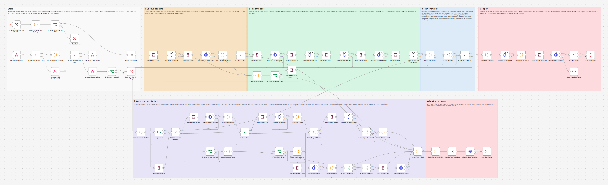
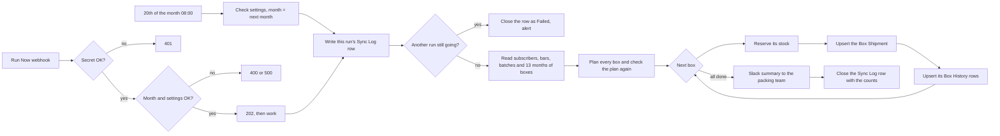

# Monthly Chocolate Subscription Box Curation

An n8n workflow that plans every subscriber's chocolate box for Demo Chocolate Co. (a made-up chocolate shop) once a month. It picks the bars from what is really in stock in Airtable, keeps every subscriber's allergies and diet safe, never sends a bar they had in their last box, balances the flavors, reserves the stock on the production batches, writes one Box Shipment with a packing list per subscriber and tells the packing team in Slack which boxes could not be filled and why.



## The problem

A subscription box sounds simple until you pack one. Every subscriber has a plan size, some are nut-free or dairy-free or vegan, some hate mint, and nobody wants last month's bars again. The bars that would fit are not always in stock, and the scarce ones should go to the subscribers who have no other option. Doing this by hand in a spreadsheet takes hours each month and one slip, a hazelnut trace in a nut-free box, is a safety problem, not a style problem. And when stock is promised to a box but not marked anywhere, the shop sells it again on Shopify.

## What this does

1. **Runs on the 20th of every month** for next month's boxes, or on demand with a protected **Run Now** webhook that takes the month (this month or next).
2. **Runs one at a time.** Before it reads anything, the run writes its row in Sync Log and checks for another curation run that is still going. A second run (a double click on Run Now, or Run Now during the monthly run) stops right there, so stock is never reserved twice.
3. **Reads the base**: Active subscribers, every bar in Products (only Active subscription bars go in new boxes), Released production batches, and 13 months of Box History and Box Shipments.
4. **Keeps every box allergen safe.** A nut-free subscriber never gets a bar with tree nuts or peanuts in *Contains Allergens* or *May Contain Traces*, and the same goes for dairy-free (milk), gluten-free (wheat) and vegan (Vegan label, no milk or eggs as ingredients). The allergen fields are cross-checked with the ingredient text, the product name, the flavor notes and the chocolate type: if any of them points to an allergen the fields do not list (almonds in the ingredients, a Hazelnut flavor note, Milk, White or Ruby chocolate), the bar stays out and the product is reported for a person to fix. The cross-checks can only add an allergen, never remove one. When stock runs short, a box stays short: a bar that breaks a need is never used to fill it. Before anything is written, a separate check reads every chosen bar's own allergen fields again and stops the run if one does not fit.
5. **Checks earlier boxes again.** A box planned before (or bars recorded by hand for the month) is never changed, but every run compares its bars with the subscriber's needs as they are today. A product that gained a nut trace since, or a subscriber who became nut-free, shows up at the top of the Slack message as a bar to take out before packing.
6. **Never repeats** a bar from the subscriber's last `REPEAT_WINDOW` boxes and never puts the same bar in a box twice. Flavor dislikes are respected.
7. **Shares out scarce stock fairly.** Longest-standing subscribers are served first, but a bar that a later subscriber with no alternatives needs is left for them when there is not enough for both. Flavor families and chocolate types are balanced inside each box.
8. **Only uses stock that is really there**: Released batches made on or before today with more than `SELL_BY_BUFFER_DAYS` days left at the ship date, oldest best before first. It reserves one unit per bar on the batch (Quantity Reserved), so the inventory sync stops offering those units on Shopify.
9. **Writes one Box Shipment per subscriber** (`BOX-<month>-<Subscriber ID>`) with the products, the batches and a readable packing list, plus one Box History row per bar.
10. **Tells the packing team in Slack**: bars to take out of earlier boxes, the counts, every box of the month that is not full and why (also boxes planned by an earlier run, which may have stopped before its summary went out), bars used up, and records a person must fix. Every run leaves one Sync Log row, a failed run too (Status Failed and the reason).
11. **Is safe to run again.** A rerun skips every subscriber who already has a box this month, so nothing is planned or reserved twice. That includes a box someone recorded by hand: bars for the month already in Box History without a Box Shipment. After a failure, the next run carries on where the last one stopped, and when Airtable saved a write but its answer got lost, the run notices instead of doing it twice or undoing it wrongly.

## How it works



Airtable allows 5 requests per second per base and answers 429 for 30 seconds after a burst. Every Airtable call in this workflow waits at least 500 ms after the previous one, which is 2 calls a second, so even two runs at the same moment stay at 4 together. Every write holds at most 10 records, Airtable's limit. The Run Now webhook answers right away with 202 and the run id; the results land in Slack and in the Sync Log.

**One run at a time.** Each run first upserts its own Sync Log row (Automation `04 Subscription Boxes`, no Status, no Finished At), waits 2 seconds and lists the curation rows that are still open. It goes on only when no other open row was created before its own; when two rows were created in the same second, the lower Run ID goes on. Airtable's `createdTime` has whole seconds, and the 2 second wait makes sure two runs that start in the same second both see both rows, so exactly one of them goes on. A row that has a Status, or is older than 60 minutes, is from a run that is not running any more and does not count. Every way the run can stop after this point closes its row first (Status Failed and the reason), so a failed run never holds the next one back. The Run ID includes the n8n execution id, so two runs never share a row.

**One box at a time.** The boxes are written in three steps: reserve the stock, upsert the Box Shipment, upsert the Box History rows. Each step is safe to repeat (stock is written as an absolute number, the other two are upserts on their keys), so n8n's retries and the rate limit wait can never double anything. If a box cannot be saved, the run first asks Airtable whether it was saved after all (the write may have gone through with the answer lost on the way back). If it was, the run carries on; if not, its reservation is given back before the run stops. If reserving the stock fails, the batches are set back to their numbers from the start of the run for the same reason.

## How a box is chosen

| Rule | How it works |
|---|---|
| Who gets a box | Subscribers with Status Active, longest tenure first (Started On, then Subscriber ID). Paused and Cancelled subscribers get nothing |
| Already has a box | A Box Shipment for the month (any status), or Box History rows for the month without a Box Shipment. The second case is a box recorded outside this workflow, which always saves the box before its history rows. Either way no new box is planned; the second case is listed in Slack |
| Earlier boxes checked again | Every bar of a box for the month that is not Cancelled (and every bar recorded for the month in Box History) is checked against the subscriber's needs as they are now, with the rules below. A bar that does not suit any more is listed first in Slack, to take out by hand. The box itself is not changed |
| Which bars | Products with Status Active, Subscription Eligible ticked and Category Bar (every bar is read, for the check above). A bar without a SKU, or two product records with the same SKU, goes in no box and is reported, because Box History tells bars apart by SKU |
| Nut-Free | No `Tree Nuts` or `Peanuts` in Contains Allergens or May Contain Traces, no nut word in the ingredients or the name (almond, hazelnut, walnut, pecan, cashew, pistachio, macadamia, peanut, praline, nougat, marzipan and others) and no Hazelnut, Almond or Peanut flavor note |
| Dairy-Free | No `Milk` in either field, no milk word in the ingredients or the name (milk, cream, butter, whey, lactose and others; cocoa butter and plant milks such as oat milk do not count), and not Milk, White or Ruby chocolate (ruby is made with milk powder) |
| Gluten-Free | No `Wheat` in either field, and no wheat, gluten, barley, rye, spelt, malt or flour in the ingredients or the name (rice, almond and other gluten-free flours do not count) |
| Vegan | The Vegan diet label, no Milk or Eggs in Contains Allergens, no animal ingredient (milk, egg, honey, gelatin and others) in the ingredient sentences or the name, no Honey flavor note, and not Milk, White or Ruby chocolate. A "made on shared equipment with milk" warning is allowed, as the label definition in the base says |
| Any dietary need | A bar without an ingredient list cannot be checked, so it only goes to subscribers without dietary needs |
| A need the workflow does not know | The subscriber is not planned and is listed in Slack, so a person picks the bars. The same happens for a missing or unknown plan |
| Dislikes | No bar whose Flavor Notes include one of the subscriber's Flavor Dislikes |
| No repeats | No bar from the subscriber's last `REPEAT_WINDOW` boxes, counting their own boxes (a paused month does not count), from Box History and from earlier Box Shipments. A Cancelled box never reached the subscriber, so neither it nor its Box History rows count |
| Stock | A batch counts when it is Released, made on or before today and has more than `SELL_BY_BUFFER_DAYS` days left at the ship date (the first day of the box month, or today when planning the current month). Units left = made minus reserved minus sold. Bars come from the batch with the earliest best before date |
| Picking | One bar at a time, ranked by: 1. leave alone a bar that a later subscriber with no alternatives needs, when there are not enough for both; 2. the flavor family with the fewest bars in the box so far; 3. the same for chocolate type; 4. the bar with the most spare stock; 5. SKU, so the same data always gives the same boxes |
| Not enough safe bars | The box stays Partial or Empty and says why. A bar that breaks a dietary need is never used to fill it, however little else is left |
| Last check | Before anything is written, the whole plan is checked again by separate code: every bar against the subscriber's needs and recent boxes, and once more straight from the product's own Contains Allergens, May Contain Traces, Diet Labels and Ingredients fields; no bar twice in a box, no batch over-reserved, at most 10 records per write. A failure stops the run before any box or stock write |

With the seed data, planning 2026-11 gives 13 boxes: 10 full and 3 partial. SUB-0004 and SUB-0011 (dairy-free) had every allowed bar but one in their October box, and SUB-0009 (vegan and nut-free) has only 3 allowed bars left for a 4 bar plan. Only 3 DC-BAR-DARK-MINT bars are in stock and SUB-0003 and SUB-0009 have no alternative to it. SUB-0002 comes before both of them in the queue and still leaves two, so it gets one; after that the bar is held for the two who need it, and the other subscribers who could have taken it (SUB-0005, SUB-0008, SUB-0012, SUB-0013) get other bars.

## Workflow at a glance

| Step | Nodes | What it does |
|---|---|---|
| Start | Schedule: Monthly On The 20th, Code: Scheduled Run Settings, IF: Scheduled Settings OK?, Stop: Bad Settings | At 08:00 on the 20th (n8n's time zone) it plans next month, in UTC. Every setting is checked first; a bad one stops the run with an alert |
| Run Now | Webhook: Run Now, IF: Run Now Secret OK?, Respond: 401 Unauthorized, Code: Run Now Settings, IF: Run Now Settings OK?, Respond: 202 Accepted, Respond: Request Error, IF: Settings Problem?, Stop: Bad Run Now Settings, Start: Curation Run | The same on demand. A wrong `X-Run-Now-Secret` gets 401, a bad month 400, a settings problem 500 plus an alert. A good call gets 202 with the run id |
| 1. One run at a time | Wait: Before Claim, Airtable: Claim Run, Wait: Lock Settle, Airtable: List Open Runs, Code: Check Open Runs, IF: Clear To Run? | Upsert this run's Sync Log row, wait 2 seconds, list the open curation rows, and go on only when no other run started first |
| 2. Read | Wait: Pace Read 1 to 5, Airtable: List Subscribers, Airtable: List Products, Airtable: List Batches, Airtable: List Box History, Airtable: List Box Shipments, Code: Read Failed, IF: Wait Out Read Limit?, Wait: Read Penalty | Five `POST .../listRecords` reads with a formula and the exact field names, paginated, 500 ms apart. Naming the fields means a renamed allergen field stops the run with an Airtable error instead of looking empty. A 429 waits 31 seconds and the run starts again from its Sync Log row, at most twice; any other error stops the run and names the table and the Airtable error |
| 3. Plan | Code: Plan Boxes, IF: Plan Failed?, IF: Nothing To Write? | Applies every rule above and checks the plan again. Stops if a read hit its page limit, so the plan is never made from a partial list |
| 4. Write | Code: One Item Per Box, Loop: Boxes, IF: Has Stock To Reserve?, Wait: Before Reserve, Airtable: Reserve Stock, Code: Stock Reserved, IF: New Box?, Wait: Before Box, Airtable: Upsert Box, Code: Box Saved, IF: History To Write?, Wait: Before History, Airtable: Upsert History | One box per pass: set Quantity Reserved on its batches, upsert the Box Shipment on Shipment ID, upsert the Box History rows on History ID. Boxes planned in an earlier run only get their missing Box History rows |
| 4. Write failures | IF: Reserve Rate Limited?, IF: Box Rate Limited?, IF: History Rate Limited?, Wait: Write Penalty, Code: Reserve Failed, Code: Box Not Saved, Wait: Before Box Check, Airtable: Find Box, Code: Box Check, IF: Box Saved After All?, IF: Stock To Undo?, Wait: Before Undo, Airtable: Release Stock, Code: Write Failed, Code: History Failed | A 429 waits 31 seconds and repeats the box's pass, at most twice per step. A box that cannot be saved is looked up first; only a box that really is not there gives its stock back. Anything else stops the run with a message that says what is saved |
| When the run stops | Code: Failed Run Fields, Wait: Before Failed Log, Airtable: Log Failed Run, Stop: Run Failed | Every failure after the start closes the run's Sync Log row as Failed with the reason, then stops the run so the error workflow posts the alert |
| 5. Report | Code: Build Summary, Slack: Post Summary, Code: Sync Log Fields, Wait: Before Sync Log, Airtable: Write Sync Log, IF: Slack Failed?, Stop: Slack Failed, Stop: Sync Log Failed | The Slack summary (bars to take out of earlier boxes first), then the run's Sync Log row gets its counts and a Finished At. A Slack failure still closes the row (Partial, 1 error), then raises an alert |

## What the team gets

A Slack message in the packing channel, from the test run (all data made up):

```
*Subscription boxes for 2026-11* (Run Now, run boxes-2026-11-2026-10-22T07:56:50Z-16490)
13 active subscribers. Planned this run: 13 boxes (10 full, 3 partial, 0 empty), 63 bars reserved from 19 batches. Planned before: 0 boxes.

*Not fully filled (3)*
• SUB-0004 Derek Olsen, 1 of 6 bars packed. The other 18 subscription bars: 14 not suitable for Dairy-Free; 4 in the last box (DC-BAR-DARK-ESPRESSO, DC-BAR-DARK-MINT, DC-BAR-DARK-SEASALT, DC-BAR-OAT-MILK).
• SUB-0009 Lucia Gomez, 3 of 4 bars packed. The other 16 subscription bars: 12 not suitable for Vegan and Nut-Free; 4 in the last box (DC-BAR-DARK-85, DC-BAR-DARK-CHILI, DC-BAR-DARK-ORANGE, DC-BAR-OAT-MILK).
• SUB-0011 Aisha Khan, 1 of 4 bars packed. The other 18 subscription bars: 14 not suitable for Dairy-Free; 1 with a disliked flavor (Mint); 3 in the last box (DC-BAR-DARK-85, DC-BAR-DARK-ESPRESSO, DC-BAR-OAT-MILK).

*Used up by this run:* DC-BAR-DARK-MINT
```

When a bar in a box planned earlier no longer suits its subscriber, the message starts with it. From the test, after DC-BAR-DARK-85 got a peanut trace and SUB-0003 added Nut-Free, both after their boxes were planned:

```
*Subscription boxes for 2026-11* (Run Now, run boxes-2026-11-2026-10-22T07:57:24Z-16492)
13 active subscribers. Nothing new to plan this run, no stock was reserved. Planned before: 13 boxes (3 not full).

*Bars to take out before packing (2)*
• BOX-2026-11-SUB-0003 for SUB-0003 Priya Raman has DC-BAR-DARK-RASPBERRY, which does not suit Nut-Free. Take it out by hand before packing.
• BOX-2026-11-SUB-0005 for SUB-0005 Elena Rossi has DC-BAR-DARK-85, which does not suit Nut-Free. Take it out by hand before packing.
This run did not change these boxes. A bar taken out still holds its Quantity Reserved, so lower it by 1 on that batch.
```

When something else needs a person, the same message gets a *Not planned* section (an unknown dietary need, a missing plan), a section for subscribers whose bars for the month are already in Box History without a Box Shipment, or a *Product data to check* section, for example `DC-BAR-DARK-SEASALT: it has the flavor note Hazelnut but Tree Nuts is not listed. It is kept out of boxes for that need until the record is fixed.` Every subscriber is listed; only a message that would pass Slack's 40,000 characters is cut short, with a pointer to Box Shipments.

In Airtable, each Box Shipment has the subscriber, the products and batches as links, Bars Planned, Bars Packed, Fill Status (Full, Partial or Empty), a Shortfall Reason when it is not full, Status Planned and a packing list:

```
Box 2026-11 for Maya Chen (SUB-0001), 6 Bars plan.
Dietary needs: Nut-Free. Dislikes: Mint.
1. DC-BAR-DARK-ORANGE, Dark Orange Zest Bar, batch B-DOR-260905 (best before 2027-09-02)
2. DC-BAR-DARK-SEASALT, Dark 70% Sea Salt Bar, batch B-DSS-260910 (best before 2027-09-07)
3. DC-BAR-MILK-CARAMEL, Milk Salted Caramel Bar, batch B-MSC-260722 (best before 2026-12-06)
4. DC-BAR-OAT-MILK, Oat Milk Chocolate Bar, batch B-OAT-260915 (best before 2027-06-09)
5. DC-BAR-RUBY-CHERRY, Ruby Cherry Bar, batch B-RCH-260930 (best before 2027-05-30)
6. DC-BAR-WHITE-COOKIE, White Cookies and Cream Bar, batch B-WCC-260826 (best before 2027-04-20)
Every bar was checked against Contains Allergens, May Contain Traces, its ingredients, name, flavor notes and chocolate type.
```

## Setup

**You need:** n8n (self-hosted, 2.x), the Demo Chocolate Co. base built with [setup/create_base.py](../../setup/create_base.py) (tables explained in [base/README.md](../../base/README.md)), and a Slack incoming webhook for the packing team. The whole system setup is in [docs/setup.md](../../docs/setup.md).

1. Import [workflow/subscription-box-curation.json](workflow/subscription-box-curation.json) into n8n.
2. Import [shared/error-alert-slack.json](../../shared/error-alert-slack.json), **activate it**, and choose it as the **Error Workflow** in this workflow's settings. n8n 2.x skips an error workflow that is not active, so without this no alert arrives.
3. Add the variables below to your n8n environment and restart n8n. The nodes read them with `$env`, so self-hosted n8n needs `N8N_BLOCK_ENV_ACCESS_IN_NODE=false`. (n8n Cloud does not allow `$env`. There, replace `$env.` with `$vars.` and create the same names under Variables.)
4. Activate the workflow. It runs at 08:00 on the 20th of each month in n8n's time zone (`GENERIC_TIMEZONE`); change the day or time in the schedule node.
5. To plan a month now, call Run Now. Without a month it plans next month (UTC); a month must be this month or next.

```
curl -X POST "https://YOUR-N8N-DOMAIN/webhook/subscription-box-run-now" \
  -H "X-Run-Now-Secret: YOUR_RUN_NOW_SECRET" -H "Content-Type: application/json" \
  -d '{"month": "2026-11"}'
```

| Variable | Required | What it is |
|---|---|---|
| `AIRTABLE_TOKEN` | yes | Airtable personal access token with `data.records:read` and `data.records:write` on the base |
| `AIRTABLE_BASE_ID` | yes | The base id from the base URL (`app` plus 14 characters) |
| `SLACK_PACKING_WEBHOOK_URL` | yes | Slack incoming webhook for the packing team's channel. Gets the monthly summary |
| `RUN_NOW_SECRET` | for Run Now | Any long random string, sent in the `X-Run-Now-Secret` header. Without it, every Run Now call gets 401 |
| `REPEAT_WINDOW` | no | Default 1. How many of the subscriber's past boxes a bar must not appear in, from 0 (repeats allowed) to 12 |
| `SELL_BY_BUFFER_DAYS` | no | Default 14. A bar needs more than this many days left before best before on the ship date. The inventory sync uses the same number |
| `SLACK_WEBHOOK_URL` | for alerts | The ops channel. The error workflow posts failed runs here |

The workflow reads Subscribers, Products, Production Batches, Box History, Box Shipments and Sync Log. It writes Box Shipments, Box History and Sync Log, and on Production Batches it only ever changes Quantity Reserved.

## Testing

The workflow was tested end to end on n8n 2.19.5 against the repo's **strict mock Airtable and Slack APIs** ([tests/mocks](../../tests/mocks)), seeded with the made-up base, so no real account was touched. The mock Airtable rejects what the real one rejects: a sixth request inside one second (then 429 for 30 seconds), more than 10 records per write, unknown field names, wrong value types, a bad formula, a link to a record that does not exist. The expected boxes come from a separate Python version of the rules in the test.

**Allergen safety is tested three ways.** Every box of every scenario is judged from its own product records, not from the reference plan. Two scenarios take the safe bars away (sold out, and 1 unit each against 22 nut-free bars) while the nut bars stay in stock. And [tests/allergen_property.js](tests/allergen_property.js) runs the planner code from the workflow file on 1,500 random bases inside n8n, where it knows every bar's true allergens, including hints the fields do not list; a broken copy of the planner that ignores May Contain Traces is run as a control and must be caught.

133 of 133 checks pass: 6 static checks of the workflow file, 125 checks across 34 scenarios run through n8n (one of them the random base check), one allergen check over every scenario together, and a final check that every temporary workflow was deleted. The run took 16 minutes, most of it the workflow's real 31 second rate limit waits.

| Scenario | Checks | What it shows |
|---|---|---|
| Workflow file | 6 | Every HTTP node retries 3 times with its error output wired; the 6 reads paginate 500 ms apart; every Airtable call comes after a Wait of at least 500 ms; the run claims its Sync Log row before any read and every failure closes it; only IF operators that exist; no dashes |
| Run Now security | 2 | 401 without the secret or with a wrong one; nothing read, no alert |
| Bad month | 2 | A malformed, past or too distant month, or a number: 400 with the reason, nothing read |
| First run for the month | 20 | 13 boxes exactly as the reference plan: 10 full, SUB-0004 1 of 6, SUB-0009 3 of 4, SUB-0011 1 of 4, each with its reason. 63 bars judged from their own product records: no allergen or diet breach, no nut trace trap (raspberry, matcha, lavender) in any of the 5 nut-free boxes, no repeat, 3 or more flavor families per full box. Quantity Reserved up by one per bar, DARK-MINT to the subscribers who need it, one history row per bar, one Slack summary, one Sync Log row, at most 2 Airtable requests in any second, no secret in the run data |
| Rerun for the same month (no month given) | 4 | No new box, reservation or history row; Slack lists the 3 short boxes again with their reasons |
| A planned box is checked again after the data changed | 3 | DARK-85 gets a peanut trace and SUB-0003 adds Nut-Free after planning: the rerun lists exactly those 2 bars first in Slack, changes nothing, and logs Partial |
| Slack is down | 1 | Slack tried 3 times, the Sync Log row still closed with 1 error, alert |
| Sync Log write fails | 1 | The Slack summary still goes out first; the alert says the row stays open |
| A Sync Log row left open holds new runs back | 3 | The next run stops after 3 Sync Log calls; a row with a Status, a 2 hour old row and another automation's row do not hold it back |
| Run Now twice at the same moment | 4 | Exactly one run plans, the other stops before reading; the boxes and stock of one run; no 429 |
| Run Now again 4 seconds later | 4 | The same, with the second call 4 seconds later |
| Box save fails mid-run, then the next run resumes | 8 | Stops after 3 tries, looks the box up, gives its stock back once, alert names the box; the next run equals one clean run and lists all 3 short boxes, the failed run's too |
| Stock reservation fails | 2 | Stops before the third box; only the first two hold stock |
| Box save and the undo both fail | 2 | The alert lists the batches to fix by hand, and the base matches it |
| Box History fails, then the next run adds the missing rows | 6 | Box and stock kept; the next run adds the 4 missing rows to the existing box with no second reservation |
| A box is saved but the answer is lost | 4 | Airtable saved the box but answered 500 three times: the run finds it and carries on, nothing given back |
| A reservation is saved but the answer is lost | 4 | The reservation that went through is set back; the next run equals one clean run |
| A field was renamed in Airtable | 2 | Stops at the read, alert names Products and UNKNOWN_FIELD_NAME, nothing written |
| Rate limit during a read (another app used up the base) | 3 | Waits 31 seconds and starts again from its Sync Log row; same boxes |
| Rate limit while saving a box | 3 | Waits 31 seconds and repeats the pass with the same absolute stock numbers; nothing reserved twice |
| Rate limit that does not go away | 1 | After 2 waits the run stops, closes its row and alerts |
| Rate limit on a box that does not go away | 1 | After 2 waits the box is looked up, its stock given back, alert |
| A page token expires in the middle of a read | 3 | The read starts again from page 1; no history row missed |
| Allergen data that does not add up (ingredients) | 5 | Almonds in the ingredient text but no nut allergen listed: kept out of nut-free boxes; a bar with no ingredient list only goes to subscribers without dietary needs; both reported |
| Allergen data that does not add up (flavor note, chocolate type, duplicate SKU) | 5 | A Hazelnut flavor note, Milk chocolate with no Milk listed and a duplicate SKU: kept out where they do not fit, reported |
| Nut-free subscribers when only nut bars are left | 4 | Every nut-safe bar sold out, one now with a peanut trace: all 5 nut-free boxes Empty with the reason, the others still get bars |
| Nut-free subscribers when the safe bars run short | 6 | Every nut-safe bar keeps 1 unit (13 for 22 nut-free bars), the trace traps lose the trace sentence from their ingredients so the field alone counts: no nut or trace bar in a nut-free box, the short ones say why, the nut bars go to others and still have stock |
| Subscriber records a person must fix | 4 | An unknown dietary need, a missing plan and a 12 bar plan are not guessed but listed; after the fix only that subscriber gets a box |
| Sold out bar | 4 | SUB-0011 gets an Empty box with the reason; no reservation or history write for it |
| Run Now for this month (the bars are already in Box History) | 3 | No box planned, nothing reserved, all 13 listed in Slack |
| A cancelled box does not count as received | 3 | The repeat check uses the box before it; the cancelled bars can come back |
| REPEAT_WINDOW=2 | 3 | No bar from either of the last 2 boxes; SUB-0004 Empty and says why |
| Settings problem | 1 | Run Now answers 500 with the reason, alert, nothing read |
| More records than one run reads | 1 | Stops before any write, alert says which read to raise |
| Random bases, the planner code from the workflow run in n8n | 3 | 1,500 random bases with scarce stock and hidden allergen hints: no nut-free subscriber ever gets a nut or trace bar, and every other rule holds; a control copy that ignores May Contain Traces is caught |
| Allergen safety, every scenario together | 1 | Every box of every scenario judged from its product records: no breach |
| Cleanup | 1 | Every temporary workflow deleted |

Full output, the requests the workflow sent, the alert texts and a mutation check (broken copies of the workflow, each caught): [docs/test-report.md](docs/test-report.md). Run the same tests yourself with [tests/e2e_mock_test.py](tests/e2e_mock_test.py) (`N8N_API_KEY` set, n8n running; about 16 minutes, most of it the real 31 second rate limit waits).

## Failure handling

| What goes wrong | What happens | What to do |
|---|---|---|
| Wrong or missing `X-Run-Now-Secret` | 401, nothing is read | Send the right secret |
| A month that is malformed, past or too far ahead | 400 with the reason, nothing is read | Use this month or next, `YYYY-MM` |
| A missing setting or a bad number | Run Now answers 500 with the reason; both triggers raise an alert. No Sync Log row, because the Airtable settings may be the problem | Fix the variable |
| Another curation run is still going (a double click, Run Now during the monthly run) | This run makes 3 Sync Log calls and stops before reading anything. Its row is closed as Failed and the alert names the other run | Nothing; the other run's summary comes to Slack |
| A read fails (wrong token, renamed field, outage) | 3 tries, then the run stops before any box or stock write. The Sync Log row says Failed and why; the alert names the table and the Airtable error | Fix it and run again |
| Airtable answers 429 (another app used up the base's limit) | 3 tries, then a 31 second wait and the run (or the box's pass) starts again, at most twice per step. After that the run stops with an alert | Run again later |
| A page token expires in the middle of a read | n8n's retry reads the table again from the first page | Nothing |
| A table has more records than one run reads (100 pages of 100) | The run stops before any box or stock write | Raise `maxRequests` on that read node |
| Reserving a box's stock fails | Its batches are set back to their numbers from the start of the run, in case the change went through and only the answer was lost. Then the run stops; the boxes before it are complete | Run again for the same month |
| Saving a box fails | Airtable is asked whether the box was saved after all. If it was, the run carries on. If not, its reservation is given back and the run stops | Run again for the same month |
| Saving a box and giving its stock back both fail | The alert lists the batches whose Quantity Reserved must be lowered by 1 | Fix them by hand, then run again |
| Saving the Box History rows fails | The box and its stock are saved, the run stops | Run again: the missing rows are added |
| Slack fails | The Sync Log row is still closed (Partial, Errors 1), then an alert | Check `SLACK_PACKING_WEBHOOK_URL` |
| Closing the Sync Log row fails | The Slack summary has already gone out, then an alert. The row stays open, so new runs wait for it for up to 60 minutes | Set a Status on that row to run sooner |
| n8n stops in the middle of a run (a restart, a crash) | The run's Sync Log row stays open. The next run stops and its alert names that row | Set a Status on the row, or wait 60 minutes, then run again |

Every alert comes from the shared error workflow and names the node and the reason, for example:

```
:rotating_light: *Monthly Chocolate Subscription Box Curation* failed at *Stop: Run Failed*
BOX-2026-11-SUB-0005 could not be saved (HTTP 500 SERVER_ERROR). Its stock reservation was undone. 4 boxes before it are saved. Run again for 2026-11 to carry on, saved boxes are skipped.
https://YOUR-N8N-DOMAIN/workflow/.../executions/...
```

## Limitations and next steps

- A rerun never changes a box that is already planned, not even a partial one, because the packing team may already be working on it. To plan a box again, delete it and its Box History rows, lower Quantity Reserved by one on each of its batches, and run again. An Empty box holds no stock, so deleting it is enough.
- The check of earlier boxes runs whenever the workflow runs for that month. The monthly schedule plans next month, so after an allergen change on a product, call Run Now for this month (and next month, if it is already planned) to see which packed or planned boxes hold it.
- Airtable has no "add 1" operation, so Quantity Reserved is read at the start of the run and written as a new number. Only one curation run writes at a time and no other automation in this repo writes Quantity Reserved, but a person who edits it by hand during a run can see the edit overwritten.
- The one-run-at-a-time check treats a row older than 60 minutes as a run that died. At 500 ms per Airtable call a box takes about 2 seconds to write, so a base with more than about 1,500 active subscribers needs a longer limit (`lockMinutes` in the settings code).
- Shipping is not part of this workflow. When a box ships, its units should move from Quantity Reserved to Quantity Sold, its Status should change and Box History's Shipped On should be filled in. When a box is cancelled, its units should be released. Both are natural next automations.
- The cross-checks look for English keywords and a few structured values. They catch a missing allergen tag such as almonds in the text or a Hazelnut flavor note, not every possible wording, so the allergen fields stay the source of truth.
- A bar received more than 12 months ago can come back (older Box History is not read). Plans larger than 10 bars are not planned, because each box is written with at most 10 records per request.
- The schedule trigger itself is not run by the tests (the test harness switches schedules off). It feeds the same settings code and nodes that Run Now uses, and those are tested.
- API keys are read from environment variables. For production, move them into n8n credentials so they never appear in the workflow.

## About

Built by **Romiel Inolino**, AI and CRM Automation Specialist working with GoHighLevel, Monday.com, ClickUp, n8n, Make and Zapier.
Portfolio and case studies: [romielwillautomate.dev](https://romielwillautomate.dev)

This repository is a portfolio implementation. Credentials, API keys and customer data are not included, and all test data is made up.
