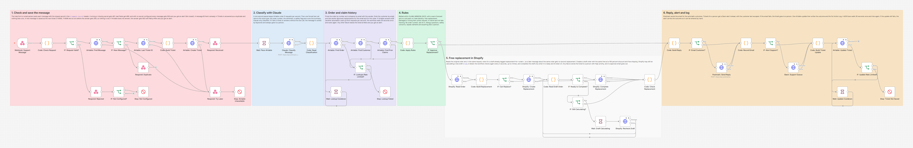
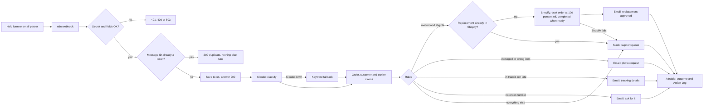

# Delivery Issue Triage for Melted, Damaged and Missing Orders

A support assistant for Demo Chocolate Co. that reads every delivery complaint, links it to the Airtable order, approves a free replacement in Shopify when the order's own data backs a melt claim, asks for a photo when something arrived broken or wrong, and sends everything else to a person in Slack. Built with n8n, Airtable, Claude, Shopify and Postmark.



## The problem

Chocolate melts. In a warm week the support inbox fills with "my bars arrived as a puddle", and every message needs the same lookups before anyone can answer: which order is it, did a cold pack go in the box, how hot was the forecast, did the parcel arrive late, has this customer claimed before. Done by hand, answers take a day, replacements get approved inconsistently, and the occasional allergy question sits in the same pile as "where is my parcel".

## What this does

1. **Takes messages from a help form or an email parser.** Each one carries a shared secret. A new message is saved as a ticket (T-0005, T-0006 and so on) before the sender gets its answer, so nothing is lost. A message ID that was already received is skipped.
2. **Classifies it with Claude.** One forced tool call returns the issue type (melted, damaged, wrong item, missing, allergy question, other), the order number as written, the sentiment, a safety flag and a one line summary. Claude only classifies. Every decision is plain code.
3. **Links the ticket** to the Airtable order by number and checks that the sender email is the email on the order, then links the customer.
4. **Applies the rules** below, using the order's own data: forecast, cold pack, expected and actual delivery dates, and earlier approved claims.
5. **Creates free replacements in Shopify:** a draft order with the same lines at a 100 percent discount and free shipping, completed into a real order once Shopify has finished calculating it. Every replacement draft is tagged `replacement-for-<order number>`, and the workflow looks for that tag first, so a later message about the same order does not get a second replacement even when its ticket does not show the first one.
6. **Replies through Postmark** for the automatic outcomes: replacement approved, photo request, tracking details, or a request for the order number.
7. **Alerts the support team in Slack** for every ticket a person must handle, with a priority.
8. **Logs every step on the ticket** (Action Log, one line per action) and writes the outcome in one update.
9. **Fails safely.** Forged requests are refused. If Claude is down, the message is sorted by keywords and goes to a person. If Shopify or the email fails, the ticket goes to a person with High priority. If Airtable rate limits a lookup or the final update, the workflow waits 35 seconds once and tries again. If Airtable is down, the sender gets 503 or you get an alert.

## How it works



The webhook answers as soon as the ticket is saved, about a second after the message arrives, and does the slow work (Claude, Shopify, email) afterwards, so a form or parser never times out and sends the message twice. If it does send it again, the repeat is answered as a duplicate.

## The rules

| Message | When | Ticket | Customer gets | Slack |
|---|---|---|---|---|
| Melted | Order found, sender email matches, delivered within `CLAIM_WINDOW_DAYS` (7), and either a warm forecast (`Forecast Max C` at least `MELT_TEMP_C`, 27) with `Cold Pack Shipped` unticked, or delivered after `Expected Delivery` | Auto-Approved, Replacement Approved | Email with the replacement order number | no |
| Melted | Shipped with a cold pack and on time, mild forecast and on time, outside the window, or not delivered yet | Human Queue | nothing yet | yes |
| Damaged or wrong item | Order found, email matches, inside the window, no photo yet | Waiting on Customer, Photo Requested | Photo request | no |
| Damaged or wrong item | Photos came with the message | Human Queue, ready to review | nothing yet | yes |
| Missing | Shipped, in transit, not past `Expected Delivery` | Resolved | Tracking number and expected date | no |
| Missing | Past `Expected Delivery`, or marked delivered by the carrier | Human Queue, High | nothing yet | yes |
| Any claim | No order number in the message | Waiting on Customer | Request for the order number | no |
| Allergy or ingredient question | Always, it is never answered automatically | Human Queue, High | nothing | yes |
| Safety concern | The customer reports a reaction, illness or injury | Human Queue, Urgent | nothing | yes |
| Any claim | Order not found, sender email does not match the order, order cancelled or refunded, order already replaced, or the customer already has `CLAIM_LIMIT` (2) approved claims | Human Queue | nothing | yes |
| Anything else | Shipping questions, compliments, gifts | Human Queue | nothing | yes |

A ticket for a person gets High priority when the customer is angry. Earlier claims are counted from Tickets with Resolution "Replacement Approved" for the same email. An order can only be replaced once: the ticket history must show no approved replacement for it, and Shopify must hold no draft tagged `replacement-for-<order number>` (that second check also covers a run whose final Airtable update failed, so its ticket never showed the approval). Dates are compared as calendar days in UTC. Claude's answer never approves anything on its own: a replacement needs the order's data to support it, so a customer who calls a crushed box "melted" still has to have a late or warm, unprotected parcel inside the window, within the per customer limit.

## Workflow at a glance

| Step | Nodes | What it does |
|---|---|---|
| 1 | Webhook: Support Message, Code: Check Request, IF: Request Valid?, Respond: Rejected, IF: Not Configured?, Stop: Not Configured | Checks the `X-Support-Secret` header (constant time) and the fields. 401 for a wrong secret, 400 with the reasons for bad fields, 503 and an alert when no secret is configured |
| 2 | Airtable: Find Message, IF: New Message?, Respond: Duplicate | Looks the message ID up in Tickets. A repeat gets 200 "duplicate" and nothing else runs |
| 3 | Airtable: Last Ticket ID, Code: Build Ticket, Airtable: Create Ticket, Respond: Received | Numbers the ticket, saves it at Status New with any photos, then answers 200 with the ticket number |
| 4 | Respond: Try Later, Stop: Airtable Unavailable | If Airtable fails while saving: 503 with `Retry-After: 60`, then an alert |
| 5 | Wait: Pace Airtable, Claude: Classify Message, Code: Read Classification | A one second pause keeps a run under Airtable's 5 requests per second. Claude classifies through a forced, strict tool call. If Claude fails 3 times or answers without the tool call, keywords take over |
| 6 | Airtable: Find Order, Airtable: Find Customer, Airtable: Find Prior Claims, IF: Lookups Rate Limited?, Wait: Lookup Cooldown, Stop: Lookup Failed | Finds the order and compares its email, finds the customer (an active record with a Shopify id wins over duplicates), and lists earlier approved replacements for this email and this order. A 429 waits 35 seconds once (Airtable blocks a base for 30 seconds) and runs the lookups again; any other failure stops with an alert |
| 7 | Code: Apply Rules, IF: Approve Replacement? | The rules table above, in plain code |
| 8 | Shopify: Read Order, Code: Build Replacement, IF: Can Replace?, Shopify: Create Replacement, Code: Read Draft Order, IF: Ready to Complete?, Shopify: Complete Replacement, IF: Still Calculating?, Wait: Draft Calculating, Shopify: Recheck Draft, Code: Check Replacement | Reads the order and, in the same request, looks for a draft tagged `replacement-for-<order>`. Copies the order's lines (current quantity, so refunded units are left out) into a draft order with a 100 percent discount, free shipping, the customer, the shipping address and that tag. While the draft's `ready` is false it checks again every 2 seconds, up to 3 times. It completes the draft only when it is ready and totals 0. Any failure sends the ticket to a person |
| 9 | Code: Build Reply, IF: Email Customer?, Postmark: Send Reply, Code: Record Email | Sends the reply from `EMAIL_FROM_SUPPORT`. Replies to an email thread keep the thread (`Re:` subject, `In-Reply-To`). A failed email sends the ticket to a person |
| 10 | IF: Alert Support?, Slack: Support Queue | Posts tickets for a person to the support channel, with the customer text escaped so it cannot ping the channel or fake a link |
| 11 | Code: Build Ticket Update, Airtable: Update Ticket, IF: Update Rate Limited?, Wait: Update Cooldown, Stop: Ticket Not Saved | One update with the classification, links, outcome, replacement ids, reply ids and the full Action Log. A 429 waits 35 seconds once and tries again. If it still fails, the alert carries the outcome |

## What the team and the customer get

A Slack alert from the test run (all data made up):

```
*Support ticket for a person* (High priority)
*T-0010* from Derek Olsen (derek.olsen@example.com) via Help Form
Issue: Melted (Claude), sentiment Angry
Order: #1021, email matches
Why: This customer already has 2 approved replacement claims (T-0001, T-0002), the limit is 2. The customer is angry.
Summary: Customer reports a delivery problem.
> Order #1021 melted AGAIN. Third time.
```

The approval email for an eligible melt claim:

```
Subject: Your free replacement for order #1012

Hi Tom,

I am sorry your chocolate from order #1012 arrived melted. That should not happen, so we are sending you a free replacement.

Your replacement order is #1026. You do not need to pay anything or send the melted bars back. You will get a shipping email as soon as it leaves our kitchen.

If anything else is wrong, just reply to this email. Your reference is T-0005.

Demo Chocolate Co. Support
```

In Airtable, the ticket shows the issue type, sentiment and method, the linked order and customer, Status, Priority, Resolution, the routing reason in plain English, the replacement draft and order, the reply message ID, and an Action Log such as:

```
2026-10-21T03:21:18.672Z Received by Help Form as T-0005
2026-10-21T03:21:19.692Z Classified as Melted (Claude), sentiment Negative
2026-10-21T03:21:19.713Z Linked to order #1012, the sender email matches the order
2026-10-21T03:21:19.713Z Approved replacements already on record for this email: 0 (limit 2)
2026-10-21T03:21:19.713Z Decision Auto-Approved, Normal priority. Free replacement approved: warm forecast (30.5 C, limit 27 C) and no cold pack, delivered 2 days ago (window 7 days).
2026-10-21T03:21:19.736Z Replacement draft #D1 created (gid://shopify/DraftOrder/1100000000001)
2026-10-21T03:21:19.747Z Replacement order #1026 created at no charge
2026-10-21T03:21:19.763Z Reply sent to tom.becker@example.com (replacement confirmation, Postmark a7b391bd-f5f0-5620-ab70-4ad9a978364e)
```

## The webhook

`POST https://YOUR-N8N-DOMAIN/webhook/support-message` with the header `X-Support-Secret: <SUPPORT_FORM_SECRET>` and a JSON body:

| Field | Required | Notes |
|---|---|---|
| `message_id` | yes | The form submission id, or the email's Message-ID header. Up to 250 characters. Repeats are skipped |
| `email` | yes | Sender email. Lowercased and trimmed before use |
| `message` | yes | The message text, up to 20,000 characters |
| `name` | no | The first name is used in the greeting when it looks like a name, otherwise the email says "Hi there" |
| `subject` | no | Email subject. Line breaks in it (and in `name`) become spaces. Email replies keep it with `Re:` |
| `order_number` | no | An order number field on the form. It wins over the number Claude reads in the text |
| `channel` | no | `help_form` (default) or `email` |
| `received_at` | no | ISO date and time. Default: now |
| `photos` | no | Up to 10 `https` URLs, as strings or `{"url", "filename"}`. Saved on the ticket in Photos |

| Answer | When |
|---|---|
| `200 {"ok": true, "status": "received", "ticket": "T-0005"}` | Saved. Triage continues in the background |
| `200 {"ok": true, "status": "duplicate", "ticket": "T-0005"}` | The message ID is already a ticket |
| `400 {"ok": false, "error": "..."}` | Missing or invalid fields, with every reason listed |
| `401` | Missing or wrong `X-Support-Secret` |
| `503` with `Retry-After: 60` | Airtable did not answer. Send it again later |
| `503` | `SUPPORT_FORM_SECRET` is not set in n8n, so every message is refused |

```bash
curl -X POST https://YOUR-N8N-DOMAIN/webhook/support-message \
  -H "Content-Type: application/json" \
  -H "X-Support-Secret: $SUPPORT_FORM_SECRET" \
  -d '{"message_id": "<help-20261021-0005@help.example.com>", "email": "tom.becker@example.com", "name": "Tom Becker",
       "subject": "Melted bars", "message": "My order #1012 arrived melted.", "channel": "help_form"}'
```

## Setup

**You need:** self-hosted n8n reachable over HTTPS, the Demo Chocolate Co. Airtable base (built by [setup/create_base.py](../../setup/create_base.py), see [base/README.md](../../base/README.md)), a Shopify custom app with the `read_orders`, `read_customers` and `write_draft_orders` scopes, an Anthropic API key, a Postmark server with a confirmed sender signature for your support address, and optionally a Slack incoming webhook for the support channel. The whole system setup is in [docs/setup.md](../../docs/setup.md).

1. Build the base and load it, as described in [docs/setup.md](../../docs/setup.md).
2. Import [shared/error-alert-slack.json](../../shared/error-alert-slack.json) and **activate it**. n8n 2.x skips an error workflow that is switched off, so no alert would arrive.
3. Import [workflow/delivery-issue-triage.json](workflow/delivery-issue-triage.json). In its settings, choose the alert workflow as the **Error Workflow**.
4. Add the variables below to your n8n environment and restart n8n. The nodes read them with `$env`, so self-hosted n8n needs `N8N_BLOCK_ENV_ACCESS_IN_NODE=false`. (n8n Cloud does not allow `$env`. There, replace `$env.` with `$vars.` and create the same names under Variables.)
5. Activate the workflow, then point the help form or email parser at `https://YOUR-N8N-DOMAIN/webhook/support-message` with the `X-Support-Secret` header. The secret must stay on the server side: let the form tool's webhook feature or your site's backend add the header, never JavaScript in the visitor's browser.

| Variable | Required | Where to find it |
|---|---|---|
| `AIRTABLE_TOKEN` | yes | airtable.com/create/tokens, with `data.records:read` and `data.records:write` on the base |
| `AIRTABLE_BASE_ID` | yes | The `app...` part of the base URL |
| `SHOPIFY_STORE_DOMAIN` | yes | `your-store.myshopify.com` |
| `SHOPIFY_ADMIN_TOKEN` | yes | Your custom app's Admin API access token (`read_orders`, `read_customers`, `write_draft_orders`). The replacement carries the customer's name, email and shipping address, which Shopify treats as protected customer data: custom apps have it available, but select those fields in the app's protected customer data settings if Shopify asks. It must be a token that does not expire, see [docs/setup.md](../../docs/setup.md) step 6 (client credentials tokens expire after 24 hours) |
| `SHOPIFY_API_VERSION` | no | Default `2026-10` |
| `ANTHROPIC_API_KEY` | yes | console.anthropic.com, API keys |
| `ANTHROPIC_MODEL` | no | Default `claude-sonnet-5`. Pick a model that allows forced tool use: `claude-opus-5-5` and `claude-fable-5-1` reject it |
| `POSTMARK_SERVER_TOKEN` | yes | Postmark, Servers, your server, API Tokens |
| `POSTMARK_MESSAGE_STREAM` | no | Default `outbound` |
| `EMAIL_FROM_SUPPORT` | yes | A confirmed sender signature, for example `Demo Chocolate Support <support@example.com>` |
| `SUPPORT_FORM_SECRET` | yes | A long random string you make up. Put the same value in the form or parser's `X-Support-Secret` header. With it empty, every message is refused |
| `SLACK_SUPPORT_WEBHOOK_URL` | no | A Slack incoming webhook for the support channel. Leave it empty to skip the alerts (the Action Log says so) |
| `SLACK_WEBHOOK_URL` | no | The ops channel, used by the error alert workflow |
| `MELT_TEMP_C` | no | Default `27`. A forecast at or above this, without a cold pack, supports a melt claim |
| `CLAIM_WINDOW_DAYS` | no | Default `7`. Days after delivery during which claims are handled automatically |
| `CLAIM_LIMIT` | no | Default `2`. A customer with this many approved replacements goes to a person |

The melt check data on each order (`Forecast Max C`, `Cold Pack`, `Cold Pack Shipped`, `Expected Delivery`, `Delivered At`) comes from [01 Shopify orders sync](../01-shopify-orders-sync) and the packing team. In Airtable, a view of Tickets filtered on Status "Human Queue" and sorted by Priority makes a simple queue for the team.

## Testing

The workflow was tested end to end on n8n 2.19.5 against the repo's **shared strict mocks** of Airtable, Shopify Admin GraphQL, Claude, Postmark and Slack ([tests/mocks](../../tests/mocks)), so no real account was touched. The mocks reject what the real APIs reject (missing auth, unknown fields, bad formulas, wrong types, more than 10 records, rate limit bursts), and the Airtable limiter was on for the whole run. The shared Shopify mock has no `DraftOrder.ready` yet, so the test file extends it with that field and with drafts that stay "calculating" for a set time. The Claude request was also checked against the real API through Anthropic's free token counting endpoint, which validates the request without generating anything.

All 81 checks pass (43 scenarios, plus 5 checks over the whole run):

| Scenario | Result |
|---|---|
| No secret, wrong secret | 401, nothing called |
| Missing message ID and bad email, photo not https, a JSON list, an unknown channel | 400 with every reason, nothing saved |
| Melted, warm forecast and no cold pack (#1012) | Answered 200 with T-0005 a second before Claude was called. Exact ticket, the order read together with the replacement tag check, one draft order with the same lines at 100 percent off and the `replacement-for-1012` tag, completed into #1026 at 0.00, approval email, 7 Airtable requests, no Slack |
| Same message delivered twice | 200 duplicate, one Airtable lookup, nothing else |
| Second message about the same order | A person decides, no second replacement |
| Melted, 3 days late (#1015) | Approved, replacement #1027 |
| Melted, cold pack and on time (#1009) / 20 days after delivery (#1003) / customer with 2 approved claims (#1021) | Human Queue with the exact reason, no Shopify call, angry customer gets High |
| Damaged (#1018), wrong item (#1020) | Waiting on Customer, photo request email, no Slack |
| Missing and 3 days late (#1022) | Human Queue, High, carrier trace |
| Missing but in transit (#1017) | Resolved, tracking email in the customer's email thread |
| Allergy question | Human Queue, High, no email, Slack text escaped (`<!channel>` cannot ping) |
| Safety concern on an order that would qualify | Urgent for a person, no replacement |
| Sender email does not match the order | Human Queue, nothing sent, customer matched by email to the record with a Shopify id |
| No order number / unknown order number | Asked for the number / a person looks it up |
| A link typed into the name field | Never reaches the email, the greeting falls back to "Hi there" |
| Damaged with photos attached | Photos saved on the ticket, a person reviews them |
| Message ID with quotes and a backslash | Saved exactly, the repeat is found and skipped |
| Claude down (529), Claude answers without the tool call | 3 tries, keyword fallback, always a person, never an approval |
| Shopify down while creating the replacement | 3 tries, Human Queue High, no approval email |
| Email bounces after the replacement was created | Replacement #1028 stays approved, ticket to a person with High priority |
| Shopify still calculating the new draft (#1023, one line fully refunded since) | Checks `ready` again after 2 seconds, then completes #1029 with only what is still on the order |
| Draft still calculating after 3 checks (#1013) | Never completed, a person completes the named draft, High priority |
| A replacement already in Shopify that Airtable does not show (#1013 again) | The tag check stops a second draft |
| Shopify user error on the draft, Shopify `THROTTLED` (#1014) | No retry on a 200 answer, a person with the reason, High priority |
| Missing but marked delivered (#1009), missing and not shipped (#1024), melted before delivery (#1017), cancelled order (#1025) | A person, each with its own reason (High for the carrier check) |
| Slack down | 3 tries, the Action Log says the alert failed, the ticket stays in the Human Queue |
| Claude answers outside the tool schema | Keyword fallback, a person |
| Line breaks in the name and subject | Saved as one line |
| Airtable rate limited while saving | 503 with `Retry-After: 60`, alert names the message |
| Airtable down during the lookups / when saving the outcome | Ticket kept at New / outcome carried in the alert, no cooldown for a 503 or 500 |
| Another client bursts the base right after the ticket is saved (a real 30 second block) / a 429 on the final update | Waits 35 seconds once, then finishes the triage and saves it, no alert |
| No Slack webhook set | Ticket still in the Human Queue, the Action Log says no alert went out |
| No `SUPPORT_FORM_SECRET` | Every message refused with 503, alert |
| Real Claude API (count_tokens) | 200, 1,342 input tokens |

Full results and the exact requests the workflow sent: [docs/test-report.md](docs/test-report.md). Run the same tests with [tests/e2e_mock_test.py](tests/e2e_mock_test.py) (about 5 minutes, over a minute of it in the two Airtable cooldowns; start it a few minutes away from 00:00 UTC):

```bash
N8N_API_KEY=... python automations/05-delivery-issue-triage/tests/e2e_mock_test.py
```

## Failure handling

| What fails | What happens |
|---|---|
| Wrong or missing secret | 401, nothing is saved |
| `SUPPORT_FORM_SECRET` not set | Every message gets 503 (fail closed) and the error alert says to set it |
| Airtable while saving the ticket | 3 tries, then 503 with `Retry-After: 60` so the sender tries again, and an alert. A resend after a success is a duplicate |
| Claude | 3 tries, then keyword sorting. The ticket always goes to a person with the reason. An answer outside the tool schema is treated the same way |
| Airtable during the lookups | 3 tries. A 429 (rate limit) then waits 35 seconds once and looks again. Anything else, or a second 429: the ticket stays at Status New and the alert says to triage it by hand |
| Shopify (order lookup, draft order, readiness check, completion) | 3 tries on HTTP errors. GraphQL errors (including `THROTTLED`), user errors, a replacement that already exists, a draft still calculating after 3 checks, a total above 0 or no order back: the ticket goes to a person with High priority and no approval email. A draft that was created is named on the ticket |
| Postmark | 3 tries, then the ticket goes to a person with High priority. A replacement that was created stays recorded |
| Slack | 3 tries, then logged on the ticket, which stays in the Human Queue |
| Airtable when saving the outcome | 3 tries. A 429 then waits 35 seconds once and tries again. Otherwise the alert carries the outcome so it can be entered by hand |

## Cost

Each new message is one Claude call of about 1,350 input tokens (measured with Anthropic's token counter) and an estimated 100 output tokens (the tool call has five short fields). At the Claude Sonnet 5 list price when this was written ($2 per million input tokens, $10 per million output) that is about 0.4 cents per message. Each new message also makes 7 Airtable requests (3 to save, 3 lookups, 1 update), a repeat makes 1, a replacement makes 3 Shopify calls (plus one for each readiness check while Shopify is still calculating the draft), and at most one email goes out.

## Limitations and next steps

- Ticket numbers come from the highest existing Ticket ID, so two messages saved in the same moment could get the same number, and the text sort works up to T-9999. An Airtable autonumber field or a counter table would remove both.
- The same message delivered twice at the same moment can create two tickets, because the lookup and the create are two requests. Repeats that arrive later are always caught. Two different messages about the same order a second or two apart (a form submitted twice) can both be approved: the second run's ticket lookup happens before the first run has saved its outcome, and Shopify's search, which the tag check uses, can trail a new draft by a few seconds. Disable the form's submit button after the first click; writing a "pending" mark on the ticket before calling Shopify would close most of that gap.
- Replies from the customer (for example the photo they were asked for) arrive as new messages and new tickets. Linking them to the waiting ticket by `In-Reply-To` is the natural next step.
- If Shopify is still calculating a new draft after 3 checks (about 6 seconds), the ticket goes to a person with the draft name, and completing it is one click in Shopify.
- A Shopify `THROTTLED` answer (the app's query cost bucket is empty, which takes another busy integration on the same app) sends the ticket to a person instead of waiting and trying again.
- Earlier claims are counted per email address, for all time. A customer who writes from another address starts at zero.
- A help form lets anyone type any email address, and the "send us your order number" email goes to whatever address was typed. Put spam protection (a captcha or rate limit) on the form. Replacements, photo requests and tracking details only go out when the email matches the order.
- Airtable allows 5 requests per second per base, shared by every automation on it. A run makes at most 4 in any one second, but several automations bursting at once can still hit the limit, and Airtable then blocks the base for 30 seconds. The intake answers 503 (the sender retries), the lookups and the final update wait 35 seconds once and try again, and only a second 429 ends in an alert.
- Orders older than 60 days need Shopify's `read_all_orders` scope. With the default 7 day claim window that never comes up.
- API keys are read from environment variables. For production, move them into n8n credentials so they never appear in the workflow, and set an execution data retention period, because runs contain customer messages.
- The email texts are fixed English templates. The Slack alert includes the customer's name and email, so post it to a private support channel.

## About

Built by **Romiel Inolino**, AI and CRM Automation Specialist working with GoHighLevel, Monday.com, ClickUp, n8n, Make and Zapier.
Portfolio and case studies: [romielwillautomate.dev](https://romielwillautomate.dev)

This repository is a portfolio implementation. Credentials, API keys and customer data are not included, and all test data is made up.
