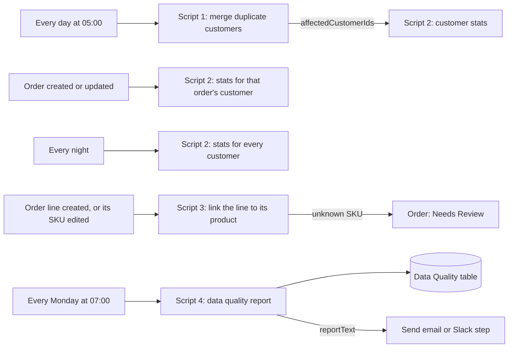

# Native Airtable Automation Scripts: duplicates, lifetime value, SKU links and data quality

Four scripts that run inside Airtable's own automations (the "Run a script" action), with no n8n, no API token and no outside service. They keep the Demo Chocolate Co. customer and order data clean: they merge duplicate customers, keep lifetime value and VIP tier up to date, link order lines to products by SKU, and write a weekly data quality report.

## The problem

Shopify orders, a CSV import and hand entry all feed the same Customers and Order Lines tables. Over time the same person ends up as two or three records with slightly different emails, so their orders are split and nobody can say who the best customers are. Imported order lines carry SKUs in the wrong case or are not linked to any product, so sales by product are off. And a broken email address goes unnoticed until an invoice or a parcel goes nowhere. Each of these takes a few minutes to fix by hand, and each is easy to miss.

## What this does

1. **Merges duplicate customers.** Customers that share an email (after trimming spaces and lowercasing) are merged into one record. The orders, tickets and subscriptions of the extra records move to the kept record, and the extras are marked Duplicate with a link to where they went, so nothing is deleted.
2. **Keeps lifetime value and VIP tier current.** When an order is created or changes, the customer's Lifetime Value, Order Count, Average Order Value and VIP Tier are recalculated. Refunds are subtracted, cancelled orders do not count, and the tier thresholds are input variables, so they can change without touching the code.
3. **Links order lines to products by SKU.** A new or edited order line is matched to its product even when the SKU has the wrong case or stray spaces. An unknown SKU is flagged on the line and on its order, for a person to check.
4. **Writes a weekly data quality report.** Missing required fields, invalid emails, order lines without an order, duplicate customers and unknown SKUs go into the Data Quality table as an issue list: new problems are added, fixed ones are closed, and a problem that is already open is never listed again. The report text is ready for an email or Slack step.
5. **Fails safely.** Every script checks the base before it reads or writes: the tables, the fields, the select options it writes and the Sync Log table. It stops with a plain message if something is missing, writes in batches inside Airtable's limits, can do a dry run, and logs every full run in the Sync Log table. A rerun never makes duplicates.

## How it works



Each box on the left is the trigger of an Airtable automation; each script is pasted into a "Run a script" action. The scripts work on the base they run in, with the permissions of the automation, so there is nothing to connect and no key to store.

## Scripts at a glance

| Script | Automation trigger | Input variables | Reads | Writes |
|---|---|---|---|---|
| [01-dedupe-customers.js](scripts/01-dedupe-customers.js) | At scheduled time, daily | `dryRun` (optional) | Customers, and the Orders, Tickets and Subscribers linked to duplicates | Customer links on moved Orders, Tickets and Subscribers; Customers; Sync Log |
| [02-customer-stats.js](scripts/02-customer-stats.js) | When record created / updated on Orders, nightly schedule, or right after script 1 | `silverThreshold`, `goldThreshold`, `platinumThreshold`; `orderRecordId` or `customerRecordIds` (optional); `dryRun` | Customers, Orders | Customers; Sync Log on full runs |
| [03-link-order-lines.js](scripts/03-link-order-lines.js) | When record created on Order Lines, when its SKU is updated, or a weekly sweep | `orderLineRecordId` (optional), `dryRun` | Products, Order Lines, Orders with an unknown SKU and their other lines | Order Lines (Product, SKU Status); Orders (Needs Review, Review Reason); Sync Log on full runs |
| [04-weekly-data-quality.js](scripts/04-weekly-data-quality.js) | At scheduled time, weekly | `dryRun` (optional) | Customers, Orders, Order Lines, Products, Subscribers, Data Quality | Data Quality; Sync Log |

Each script also sets output values for later steps in the same automation: counts, the list of records it changed, a one line `summary`, and for script 4 the full `reportText`.

## The rules

**Which customer record is kept.** In each group of customers with the same email, the kept record is the one with a Shopify Customer ID, then the one with the most orders, then the one with the most contact details filled in, then the one that came from Shopify, then the lowest record id, so the choice never changes between runs. On the seed this keeps the Shopify records of Maya Chen, Jordan Blake and Priya Raman. A missing name or phone number is copied to the kept record, and a kept email stored with capitals or spaces is written in its clean form. Accepts Marketing is never copied: consent stays on the record it was given on. A group where two records have different Shopify Customer IDs is not merged; it is listed for a person, because those may really be two people.

**Lifetime value and VIP tier.**

| Field | Rule |
|---|---|
| Lifetime Value | Sum of Total minus Refunded Amount over the customer's orders, cancelled orders left out |
| Order Count | Orders that were not cancelled |
| Average Order Value | Lifetime Value divided by Order Count, rounded to the cent. Empty when the count is 0 |
| VIP Tier | Platinum, Gold or Silver once Lifetime Value reaches that threshold, otherwise Standard |
| Stats Updated At | Set whenever one of the numbers above changes |

A customer with no counted order gets Lifetime Value 0 and Order Count 0 written as real zeros. Money is added up in whole cents, so 1.10 + 2.20 is 3.30 and not 3.3000000000000003.

**SKU matching.** The line's SKU and the product SKUs are compared without spaces and in capitals. One match: the line is linked and marked Matched. The SKU text itself is left as Shopify or the import sent it: the Shopify orders sync (automation 01) writes that field on every order update, so a cleaned copy written here would only be changed back, and each change would start this script again. No match: the line is marked Unknown SKU and its order gets the line "Unknown SKU DC-BAR-GINGER on line 14100000101103." in Review Reason, once per line, with Needs Review ticked when the line is added. Once a person has dealt with it they can untick Needs Review and leave the text; the order is not flagged again unless another line turns up with an unknown SKU. A link that a person made by hand is never removed. No SKU at all (a gift wrap line): Missing SKU. Two products with the same SKU: nothing changes and the line is listed, because picking one would be a guess.

The order's reasons are worked out from all of its lines, not only the line that started the run. Airtable starts one run per created line, so when two lines with unknown SKUs land on one order together (an import, for example; the Shopify sync creates a Draft product for an unknown SKU and links it, so its lines match), two runs work on that order at the same moment. Both write the same complete Review Reason, so neither one wipes out the other's line.

**Data quality checks.**

| Check | What it finds | Severity | On the seed |
|---|---|---|---|
| Missing Required Field | Customers without Name or Email, Orders without Customer or Email, Products without Name, Status or Category | Medium | Grace Kim (no email; her subscription has one, and the finding says so), Kai Morgan (no name) |
| Invalid Email | Customer or order emails that are not a usable address once trimmed | Medium | sam.ortiz@example, lena.fischer.example.com, tom.nguyen@@example.com |
| Orphan Order Line | Order lines not linked to any order | High | LEGACY-0001 |
| Duplicate Customer | Active customers that share an email (all but the record script 1 would keep) | Medium | The second Maya Chen, Jordan Blake and Priya Raman records |
| Unknown SKU | Order lines whose SKU matches no product | High | DC-BAR-GINGER on order #1011 |

Customers already marked Duplicate are history and are not checked.

**How findings stay unique.** A new problem gets one row with Finding ID `<ISO week> / <check> / <record id>`, for example `2026-W43 / Invalid Email / recvy3ILOPTnxWoIk`, where the week is the week it was first found. While that row is Open or Ignored, no second row is made, this week or any later week. When the problem is gone, the row is set to Fixed with a dated note in Details. If a problem comes back after its row was closed, it gets a new row for that week. Rows without a Record ID, such as the hand written `2026-W42 / Invalid Email / sam`, are left exactly as they are.

## What the team gets

The weekly report, as the test run produced it on the seed (all data made up):

```
Data quality report 2026-W43 (2026-10-20)
10 open problems: 10 new, 0 already listed, 0 opened again. 0 fixed since the last check.
- Missing Required Field: 2 (Grace Kim, Unnamed record (kai.morgan@example.com))
- Invalid Email: 3 (Lena Fischer, Sam Ortiz, Tom Nguyen)
- Orphan Order Line: 1 (LEGACY-0001)
- Duplicate Customer: 3 (Jordan Blake, Maya Chen, P. Raman)
- Unknown SKU: 1 (14100000101103)
- Order lines with a known SKU but no product link: 2 (script 3 links them)
- Older open findings without a Record ID, left as they are: 1
```

After script 1 and script 3 have run, the same report shows 7 open problems and "3 fixed since the last check". A merged duplicate keeps its history and says where it went:

```
Record Status: Duplicate
Merged Into:   Maya Chen
Notes:         2026-10-20: duplicate of Maya Chen (rec0kKPgfSt7SmcnH), merged by the dedupe script. Moved: #1004.
```

The kept record gains the line `2026-10-20: merged 1 duplicate record with the same email: Maya Chen (rechh5z9mNyFBCzQH).` and, once script 2 has run, Lifetime Value 49.90 over 2 orders, Silver.

## Setup

**You need:** an Airtable base built from [base/schema.json](../../base/schema.json) (run [setup/create_base.py](../../setup/create_base.py), see [docs/setup.md](../../docs/setup.md)), a plan that includes the "Run a script" automation action (Airtable offers it on all plans with different limits, but not during a Team plan trial), and Creator or Owner access to the base.

1. For each row in the table below, create an automation in the base: add the trigger, add a "Run a script" action, paste the whole script file into the editor, and add the input variables. Step by step, with every setting: [docs/airtable-setup.md](docs/airtable-setup.md).
2. Test each one with `dryRun` set to `true` first. Airtable's Test button runs the script for real against your base, and a dry run shows what would change without writing anything.
3. Remove `dryRun` (or set it to `false`) and turn the automation on.

| # | Automation | Trigger | Script | Input variables |
|---|---|---|---|---|
| 1 | Customers: merge duplicates | At scheduled time, every day 05:00 | 01, then 02 as a second action | Script 1: none. Script 2: the three thresholds, `customerRecordIds` = `affectedCustomerIds` from script 1 |
| 2 | Customer stats: new order | When record created, table Orders | 02 | `orderRecordId` = Airtable record ID, the three thresholds |
| 3 | Customer stats: order changed | When record updated, table Orders, fields Customer, Total, Refunded Amount, Order Status | 02 | `orderRecordId` = Airtable record ID, the three thresholds |
| 4 | Customer stats: nightly | At scheduled time, every day 02:00 | 02 | the three thresholds |
| 5 | Order lines: new line | When record created, table Order Lines | 03 | `orderLineRecordId` = Airtable record ID |
| 6 | Order lines: SKU edited | When record updated, table Order Lines, field SKU only | 03 | `orderLineRecordId` = Airtable record ID |
| 7 | Data quality: weekly report | At scheduled time, every Monday 07:00 | 04, then a Send email or Slack action | none. The email body is `reportText` from script 4 |

Automation 3 is needed as well as 2 because Airtable's "When record updated" trigger does not run when a record is created. A weekly sweep of every order line (script 3 on a schedule, no input) is optional but recommended: it catches lines from an import and repairs an order flag that two runs at the same moment could have missed (see Limitations).

| Input variable | Script | Required | Value |
|---|---|---|---|
| `silverThreshold` | 02 | yes | Lifetime value in dollars for Silver, for example `40` |
| `goldThreshold` | 02 | yes | For Gold, for example `75`. Must be above Silver |
| `platinumThreshold` | 02 | yes | For Platinum, for example `150`. Must be above Gold. `$1,000` style text is fine |
| `orderRecordId` | 02 | no | The trigger's Airtable record ID. Recalculates that order's customer |
| `customerRecordIds` | 02 | no | A list of customer record ids (or comma separated text), such as `affectedCustomerIds` from script 1. Set but empty (a day with nothing to merge): nothing is recalculated, the nightly run covers everyone |
| `orderLineRecordId` | 03 | no | The trigger's Airtable record ID. Without it, every line is checked |
| `dryRun` | all | no | `true` reports what would change and writes nothing, not even Sync Log |

If you would rather keep the thresholds in the code, fill in `FALLBACK_THRESHOLDS` at the top of script 2; an input variable that is set still wins. There are no environment variables and nothing to add to `.env`: the scripts never leave Airtable.

Script 1 makes no changes to a group it is unsure about, and the Notes on both records say what moved, but a merge is not undone automatically. Run it once with `dryRun` and read the `merges` and `conflicts` output before you turn it on.

## Testing

Airtable cannot run these scripts outside Airtable, and this repo never touches a real base. So the scripts run, unchanged, inside [tests/airtable-scripting-sim.mjs](tests/airtable-scripting-sim.mjs): a strict stand-in for the automation scripting environment, loaded with the base blueprint and the seed data. It follows the Airtable scripting docs and the "Run a script" limits, and refuses what Airtable refuses:

- reads: unknown field names, `getCellValue` on a field the query did not load ("Cell values for field ... are not loaded"), more than 100 `recordIds` in one query, more than 30 queries in one run. Cells come back in the scripting format: empty is `null`, a link is `[{id, name}]`, a select is `{id, name, color}`. Records come back in an arbitrary but stable order, so a script cannot lean on the order of the seed files.
- writes: more than 50 records in one call, unknown fields, a select written as text or with an option that does not exist, links written as anything other than `[{id}]` or to a record that does not exist, numbers as text, a date where a date time belongs. Writing one side of a link updates the other side, as in Airtable.
- limits and runtime: more than 15 writes started inside one second (writes fired in parallel), a write that is not awaited, no `setTimeout`, no extension only APIs such as `output.markdown`, and `output.set` only takes JSON values.

All 94 checks across 26 scenarios pass ([full output](docs/test-report.md)):

| Scenario | Result |
|---|---|
| The stand-in itself | Refuses 51 records in one call, unloaded and unknown fields, 9 kinds of badly formatted values, parallel writes, a 31st query and extension only APIs |
| Data quality report on the seed | Exactly the 10 expected findings, with full details and severities, one batched write, 6 queries, the hand written older finding untouched |
| Data quality rerun and dry run | No new rows, nothing changed; the dry run writes nothing at all |
| Merge duplicates on the seed | Keeps the Shopify record in all 3 groups, moves orders #1004 and #1011, writes only those 2 orders and 6 customers |
| Merge rerun, late links, conflicts | Nothing to do on a rerun; an order and a ticket that reached a merged record later move on; a group with two Shopify Customer IDs is left Active and listed; consent is not copied |
| Customer stats on the seed | Lifetime Value and Order Count match the seed facts for all 22 customers with orders, zeros for the other 9, tiers Gold 1, Silver 5, Standard 25, 31 customers in one write |
| Stats after the merge, for one order, and the nightly run | Maya 49.90 and Jordan 74.35 after the merge; a cancellation, a refund and an order moved to another customer each give the right numbers |
| Stats input variables | Missing, non numeric or descending thresholds and a malformed record id fail before anything is written; a value equal to a threshold reaches the tier; money is added in whole cents |
| Order line linker | The two imported #1004 lines are linked (one only after trimming and uppercasing) with their SKU text left as imported, DC-BAR-GINGER flags order #1011 once, the gift wrap and orphan lines are untouched, a SKU shared by two products changes nothing |
| The order flag and runs at the same moment | A person who unticks Needs Review is not overruled by the next sweep; a second unknown SKU flags the order again; two lines of one order checked at the same moment both end up in Review Reason; a SKU that becomes known links the line and leaves the flag for the person |
| Data quality over two weeks | The 3 duplicate findings close after the merge; a week later only the 2 genuinely new problems get rows, a fixed email closes its finding, an Ignored finding is left alone |
| Scale | 310 findings, 123 merges, 331 customer updates and 122 line links, all in calls of at most 50 records and at most 30 queries per run |
| Real clock, turn of the year, a base that differs | Report week follows the real date; 2027-01-01 is 2026-W53; a renamed field or table stops the script before it writes, with a message that names it |
| Checks before the first write | With no Sync Log table, all four scripts stop before their first read or write; a renamed select option (Duplicate, Partial, a Data Quality check) stops the run before it writes; script 4 checks Subscribers too |

The test suite itself is checked too: [tests/mutation-check.mjs](tests/mutation-check.mjs) breaks the scripts in 18 realistic ways and the suite fails for every one of them. Among them: ranking skipped, consent copied, money added in floating point, a tier boundary off by one, parallel writes, 100 records per call, SKUs compared without trimming, reruns that ignore existing findings, a select written as text, a wrong ISO week, the cleaned SKU written back, Needs Review ticked again on every run, a one-line run that ignores the order's other lines, and Sync Log checked only after the writes.

Run them yourself (Node 18 or later, no packages, no network):

```
node automations/06-airtable-native-scripts/tests/run-tests.mjs
node automations/06-airtable-native-scripts/tests/mutation-check.mjs
```

Or run both through the same entry point as the other automations (no n8n needed for this one): `python automations/06-airtable-native-scripts/tests/e2e_mock_test.py`, with `--quick` for the first only.

What the stand-in cannot prove: the scripts have not been run in a real Airtable base. Where the docs give a rule but not the error text (the 50 record and 30 query messages, an unknown table, a record id that does not exist), the stand-in's message is close to Airtable's but may differ. Where the docs are silent it is stricter than Airtable is likely to be: it needs the primary field loaded before `record.name` works, rejects `{id, name}` link values, and skips record ids that do not exist in a `recordIds` query. The scripts are written to work under both readings. The test for two runs at the same moment starts both runs together with an 80 ms write time; real runs can interleave differently (see Limitations).

## Failure handling

- **A base that differs from the blueprint.** Every script checks the tables, fields and select options it needs, Sync Log included, before it reads or writes, and stops with a message such as `The Customers table has no field called "Merged Into". Rename the field in Airtable or change the name in this script.` Options matter because an automation script cannot add one: writing `{name: "Duplicate"}` to a field that has no such option fails, so a renamed option would otherwise stop a run half way.
- **Bad input variables** (missing or non numeric thresholds, thresholds that go down, a malformed record id) stop the run before anything is written.
- **Every failure is visible.** The script adds a Failed row to Sync Log with the reason, then rethrows, so Airtable marks the run as failed in the automation history and emails the person who turned the automation on ("Something went wrong with an automation"). If even Sync Log is missing, the reason still reaches the run history and the log problem goes to the console.
- **Reruns are safe.** Only records that need a change are written, so a run that stopped half way can simply run again: script 1 finds the remaining duplicates, script 2 the stale numbers, script 3 the unlinked lines, script 4 the missing findings.
- **Inside Airtable's limits.** Writes go 50 records per call, each call awaited before the next so writes never pile up in parallel (Airtable allows 15 per second), record ids are read 100 per query, and no run comes close to 30 queries.
- **Unsure cases go to a person**, not to a guess: two Shopify Customer IDs in one email group, a duplicate whose Merged Into leads nowhere, a SKU shared by two products, an unknown SKU.

## Limitations and next steps

- Script 2 on an order update sees only the order's current customer. When an order moves from one customer to another, the old customer is corrected by the nightly full run (automation 4) or by the merge automation, not straight away. The tests show both.
- Duplicates are found by email only. Two records for one person with different emails, or a shared family email, need a person.
- When an unknown SKU later becomes known (the product is added, or the SKU on the line is fixed), the line is linked and marked Matched, but the order keeps Needs Review and its reason line. A person clears them, because the order may still need a look (stock, packing).
- Airtable scripts cannot lock a record. Runs for two lines of one order agree on the Review Reason because each one reads all of the order's lines, but a write can still land on stale text in a rare timing: a person editing that Review Reason in the same second, or a new line arriving between another run's read and its write. The line itself is still marked Unknown SKU and listed in the weekly data quality report, and the weekly sweep (script 3 on a schedule) writes the missing reason line back to the order.
- A merge is not undone automatically. Merged Into and the Notes on both records say exactly what moved, and Airtable's record history and base snapshots can restore the rest.
- The checks and required fields are set in the code (`REQUIRED` and `SEVERITY` at the top of script 4). Adding a check means a new option in the Data Quality Check field and a few lines of code.
- The email check is a format check. It cannot tell whether a mailbox exists.
- The scripts' Sync Log Run IDs have a resolution of one second, so two runs of one script in the same second get two Sync Log rows with the same Run ID. Each run creates its own row, so nothing is overwritten.
- The scripts read whole tables in one query each. Airtable gives an automation script 120 seconds (30 before a temporary increase) and 512 MB; at tens of thousands of customers, split the work by view or move the nightly run to an n8n workflow.

## About

Built by **Romiel Inolino**, AI and CRM Automation Specialist working with GoHighLevel, Monday.com, ClickUp, n8n, Make and Zapier.
Portfolio and case studies: [romielwillautomate.dev](https://romielwillautomate.dev)

This repository is a portfolio implementation. Credentials, API keys and customer data are not included, and all test data is made up.
