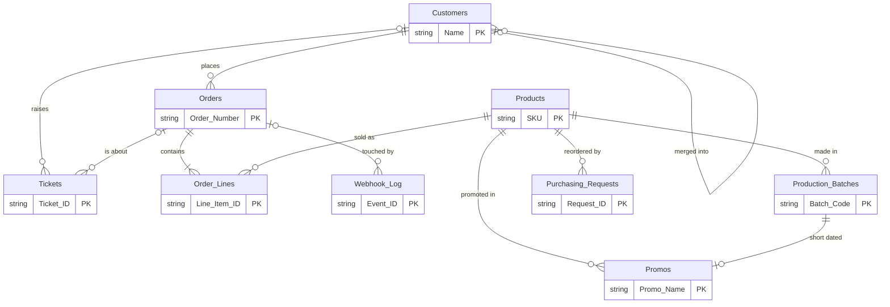
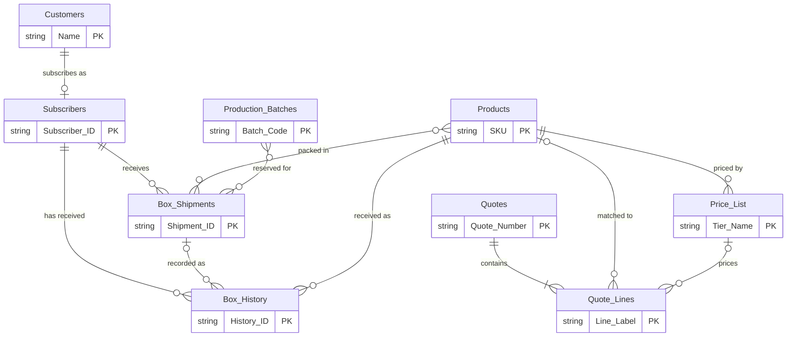

# The Airtable base

Every automation in this repo works on one Airtable base for Demo Chocolate Co., a made-up chocolate shop that sells on Shopify, runs a monthly subscription box and takes wholesale orders. This folder holds the blueprint of that base and the fake data used to test against it.

| File | What it is |
|---|---|
| [schema.json](schema.json) | Every table and field, with real Airtable field types and options. The first field of each table is its primary field. |
| [seed/](seed) | Fake records for each table, one JSON file per table, plus [seed/_meta.json](seed/_meta.json) with the load order and the facts the tests rely on. |

To build the base in your own Airtable account, run [setup/create_base.py](../setup/create_base.py). It creates the tables and fields through the Metadata API and loads the seed through the Web API. See [docs/setup.md](../docs/setup.md).

## How the tables connect

Orders, customers and stock:

Wholesale quotes and the subscription box:

Two tables stand alone: **Sync Log** (one row per automation run) and **Data Quality** (findings from the weekly check). In the diagram, spaces in names are written as underscores; in Airtable they are normal names such as `Production Batches` and `Contains Allergens`.

## The tables

| Table | Primary field | Records in the seed | What it is for | Used by |
|---|---|---|---|---|
| Products | SKU | 23 | Everything the shop makes. The SKU matches the Shopify variant SKU. Allergens, traces and diet labels drive the subscription box safety rules. | 01, 02, 03, 04, 06 |
| Production Batches | Batch Code | 31 | The source of truth for stock: one row per batch, with best-before date and how many units were made, reserved and sold. | 02, 03, 04 |
| Customers | Name | 31 | One row per customer, matched by Shopify Customer ID, then by trimmed lowercase email, and updated by record id or created (never upserted on Email). Includes deliberate duplicates and bad emails. | 01, 05, 06 |
| Orders | Order Number | 25 | Shopify orders with shipping, melt-risk and delivery details. | 01, 05, 06 |
| Order Lines | Line Item ID | 50 | One row per Shopify line item, linked to the order and to the product by SKU. | 01, 06 |
| Price List | Tier Name | 19 | Wholesale price tiers by quantity. | 03 |
| Quotes | Quote Number | 5 | Wholesale quotes, from inquiry to Shopify draft order. | 03 |
| Quote Lines | Line Label | 7 | One row per product requested in a quote. | 03 |
| Subscribers | Subscriber ID | 15 | Monthly box subscribers with plan size, dietary needs and flavor dislikes. | 04 |
| Box Shipments | Shipment ID | 0 | One row per subscriber per month, written by the curation workflow. | 04 |
| Box History | History ID | 145 | Every bar each subscriber received, one row per bar. | 04 |
| Tickets | Ticket ID | 4 | Delivery support messages and what was done about them. | 05 |
| Promos | Promo Name | 1 | One promo per short dated batch. | 02 |
| Purchasing Requests | Request ID | 2 | Requests to make more of a product. One open request per SKU at a time. | 02 |
| Sync Log | Run ID | 2 | One row per automation run, with counts. 05 logs on each ticket's Action Log instead. | 01, 02, 03, 04, 06 |
| Data Quality | Finding ID | 1 | Findings from the weekly data quality script. | 06 |
| Webhook Log | Event ID | 1 | Every webhook received, so a repeat delivery is skipped. | 01 |

## Keys that keep reruns from creating duplicates

| Table | Matched on | Notes |
|---|---|---|
| Customers | Shopify Customer ID, then Email | Look the customer up by `{Shopify Customer ID}` first, then with `LOWER(TRIM({Email}))`, then update that record by id or create a new one. Never an upsert on Email: Email is an email field, which is not one of the field types Airtable documents for `fieldsToMergeOn`, and the seed has an exact duplicate (below). |
| Orders | Shopify Order ID | `Shopify Updated At` holds the `updated_at` of the last webhook applied, so an older webhook can be ignored. |
| Order Lines | Line Item ID | Shopify's line item id, as text. |
| Products | SKU | Unknown SKUs are created with Status `Draft`, `Needs Review` ticked and a `Review Reason`. |
| Webhook Log | Event ID | The `X-Shopify-Webhook-Id` header. |
| Quotes | Inquiry ID | The form submission id. `Quote Number` is the readable number (next one: Q-2026-0046). |
| Tickets | Message ID | The incoming message id. |
| Box Shipments | Shipment ID | `BOX-<YYYY-MM>-<Subscriber ID>`, for example `BOX-2026-11-SUB-0001`. |
| Promos | Promo Name | `PROMO-<Batch Code>`, so a batch never gets two promos. |
| Purchasing Requests | SKU and Status | 02 first looks for a request for the SKU that is still in progress (Status `Open` or `Scheduled`), then creates through an upsert on SKU + Status (both valid merge field types), so two runs at the same moment cannot open two requests. |
| Data Quality | Finding ID | `<ISO week> / <check> / <record id>`. The week is the week the problem was first found: while a finding for the same check and record is Open or Ignored, later weeks add no new row. |
| Sync Log | Run ID | For example `inventory-2026-10-20T06:00:00Z-48213` (start time plus the n8n execution id, so two runs in the same second get two rows). |

## Field conventions

- **Links** are arrays of record ids, both when reading and when writing through the Web API. Links meant to hold one record (an order line's `Order`, a batch's `Product`) are marked `prefersSingleRecordLink` in schema.json. The Metadata API cannot set that option, so `setup/create_base.py` creates them as normal links; switch "Allow linking to multiple records" off in Airtable if you want the UI to enforce it.
- **Both sides of a link** are listed in schema.json. The side marked `createdAutomatically: true` is the inverse field Airtable creates on its own; the setup script then gives it the name and description from the blueprint.
- **Derived numbers are plain fields.** Sellable stock, totals, lifetime value and VIP tier are written by the automations. That is a choice: each number has one writer with tests behind it, and the base works without any formula, rollup or lookup fields.
- **Upsert keys** (`performUpsert.fieldsToMergeOn`) must be number, single line text, long text, single select, multiple select or date fields, as the Update records reference says. Every key in the table above that is used for an upsert is a single line text field.
- **Dates** are `date` fields (`2026-11-03`). **Times** are `dateTime` fields in the America/New_York time zone, written in UTC (`2026-10-20T14:05:00.000Z`).
- **Money** is a `currency` field in USD with two decimals. Shopify sends money as strings, so convert before writing.
- **Allergens:** `Contains Allergens` lists real ingredients, `May Contain Traces` lists shared equipment warnings. A nut-free subscriber must get neither tree nuts nor peanuts in either field.
- **Empty values are not returned** by the Web API: an unticked checkbox, an empty text or an empty link simply has no key in `fields`. A number 0 is a value and is returned as 0, so write 0 when you mean zero (for example a customer with no orders) and treat a missing number as "not set".

## The seed data

All data is made up. Phone numbers use the 555 range and every email uses example.com (a few are broken on purpose). The seed was written for `seedToday` = 2026-10-20 in [seed/_meta.json](seed/_meta.json). The test mocks shift every date so that day becomes today, which keeps facts such as "best before in 15 days" or "delivered 2 days ago" true on any day. `setup/create_base.py --shift-dates-to-today` does the same when you load a real base. Text that contains a date, such as batch codes (`B-DSS-260523`) and box months (`2026-10`), is not shifted.

Each record has a `ref` that is unique within its table, and link fields in the seed list refs. The setup script turns refs into record ids.

The seed contains realistic mess, on purpose, so each automation has something real to handle:

| Trap | Where | Who has to cope |
|---|---|---|
| Two customers with exactly the same email (`jordan.blake@example.com`). An upsert keyed on email would match both and fail with 422, which is one more reason to look customers up and write by record id. | Customers | 01, 06 |
| The same person with different case and spaces in the email (`Maya.Chen@Example.com `, ` PRIYA.RAMAN@EXAMPLE.COM`). | Customers | 06 |
| Invalid emails (`sam.ortiz@example`, `lena.fischer.example.com`, `tom.nguyen@@example.com`), a customer with no email and one with no name. | Customers | 06 |
| A batch past its best-before date that is still marked Released (`B-DAL-260314`). | Production Batches | 02, 04 |
| A batch inside the sell-by buffer (`B-D85-260403`, 10 days left) and batches right on the promo window edge (45 days) and one day outside it (46 days). | Production Batches | 02 |
| Planned and On Hold batches that must not count as stock. | Production Batches | 02, 03, 04 |
| Products that only carry a nut trace warning (`DC-BAR-DARK-RASPBERRY`, `DC-BAR-WHITE-MATCHA`, `DC-BAR-MILK-LAVENDER`), and an oat bar that may contain wheat. | Products | 04 |
| A wholesale product that is not on Shopify (`DC-PRALINE-HAZELNUT`) and a draft product created from an unknown SKU (`DC-BAR-PUMPKIN-SPICE`). The draft exists in the Shopify store but has no Shopify ids or batches in Airtable, so the inventory sync must skip it rather than set its Shopify stock to 0. | Products | 02, 03 |
| An inactive old price tier (`DC-BAR-DARK-SEASALT 300+ (old)`). | Price List | 03 |
| Order lines with no product link: a legacy import, a lowercase SKU with a leading space, an unknown SKU, a gift wrap line with no SKU, and an orphan line with no order. | Order Lines | 06 |
| An approved quote not processed yet (Q-2026-0042) next to one already converted (Q-2026-0043). | Quotes | 03 |
| A customer with two approved melt claims already (Derek Olsen). | Tickets | 05 |
| A paused and a cancelled subscriber, and dairy-free subscribers with only one bar left that they have not had last month. | Subscribers | 04 |
| The latest boxes (month `2026-10`, the current month on the seed day) are in Box History with no Box Shipments, because they predate the workflow. A run for that month must treat Box History rows without a Box Shipment as a box already received. | Box History | 04 |

[seed/_meta.json](seed/_meta.json) lists the exact numbers the tests can rely on under `expected`: sellable stock per SKU and which SKUs changed, promo and purchasing request candidates, every subscriber's allowed bars, the wholesale example quote, the delivery claim scenarios, and the customer stats and data quality findings.
